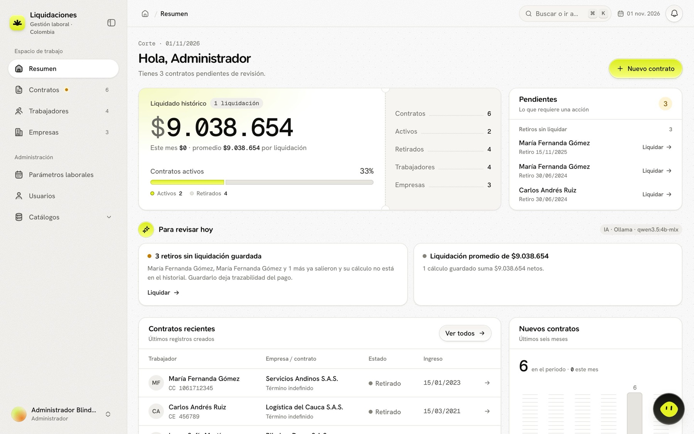
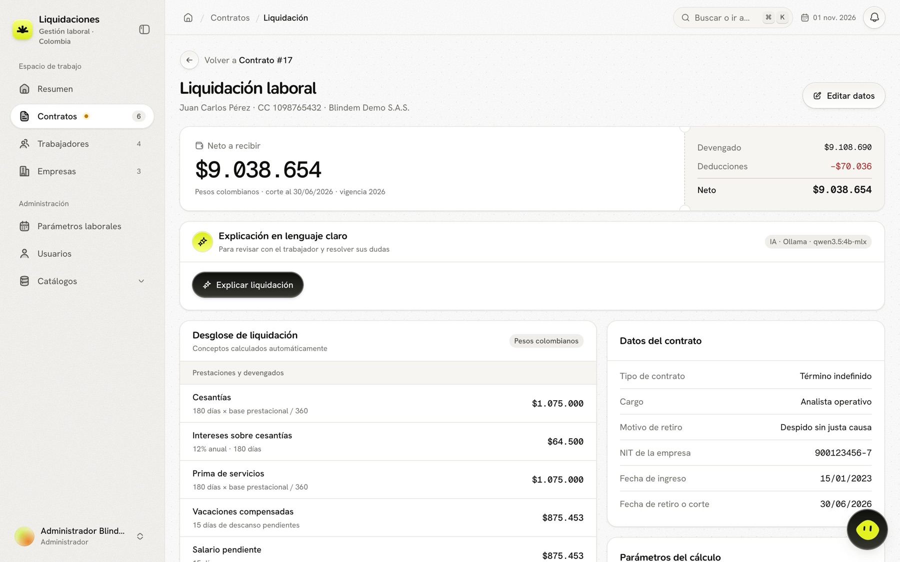
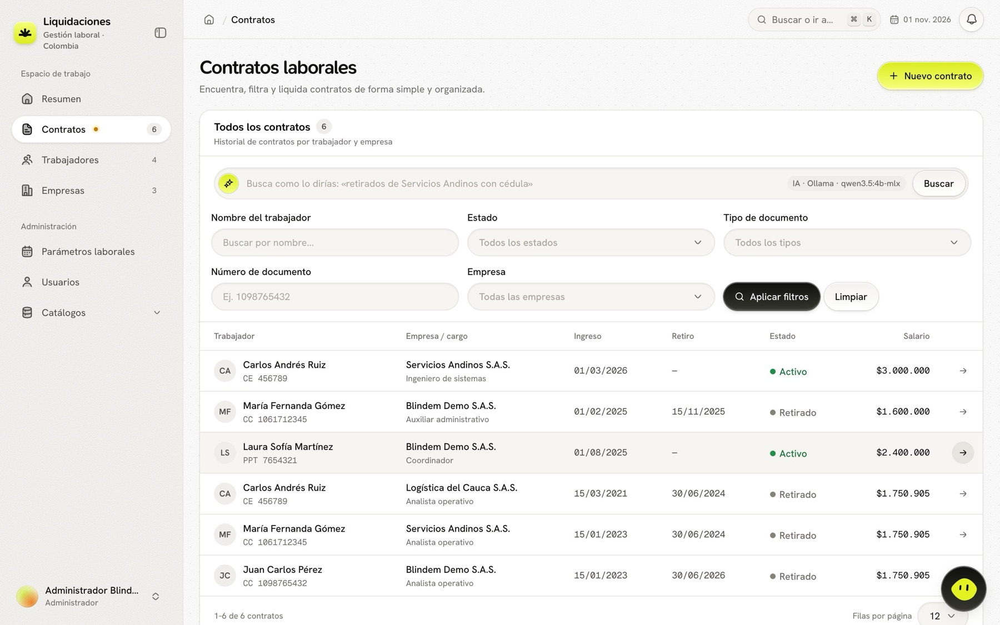
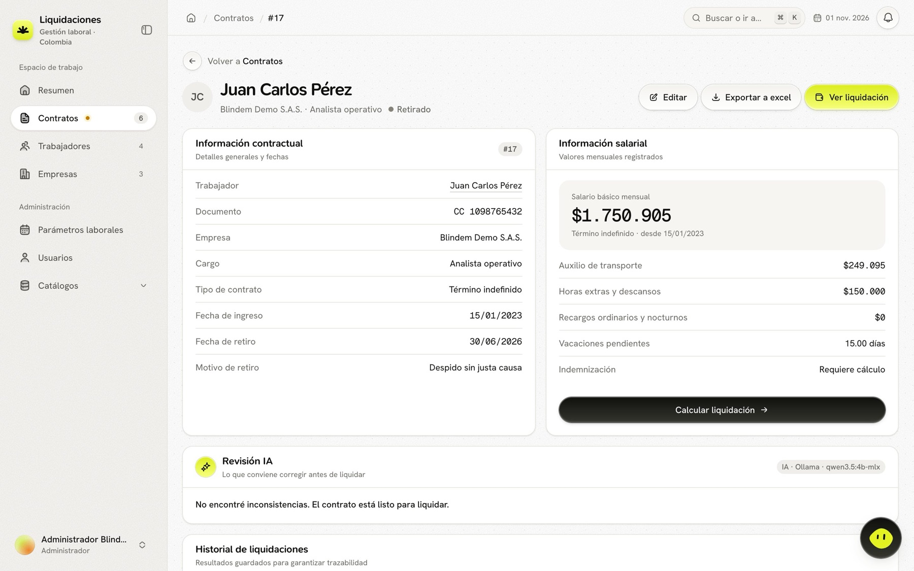
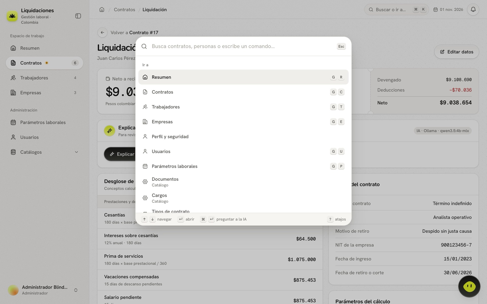
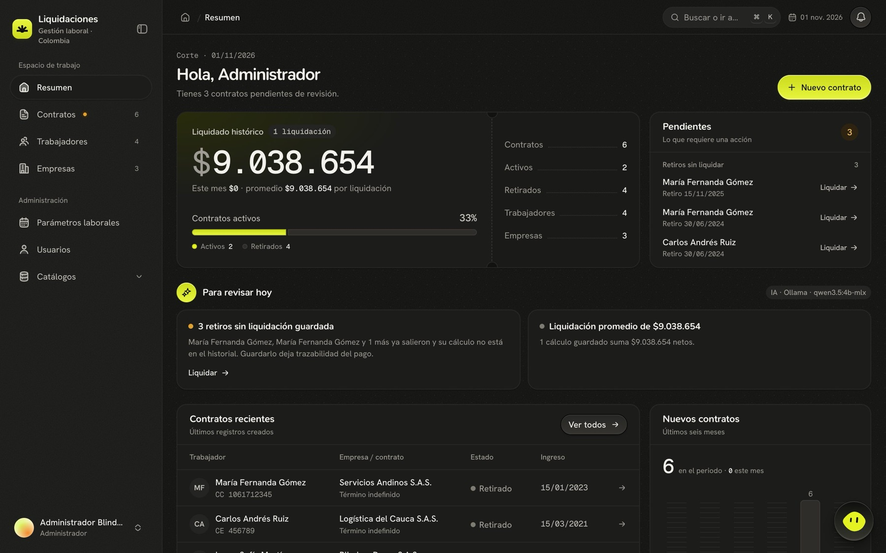
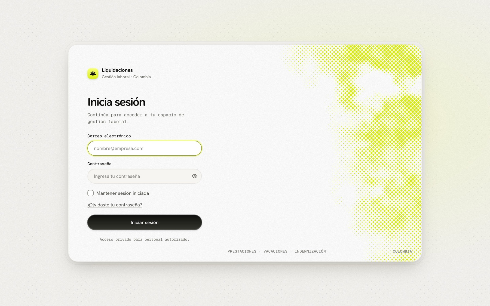
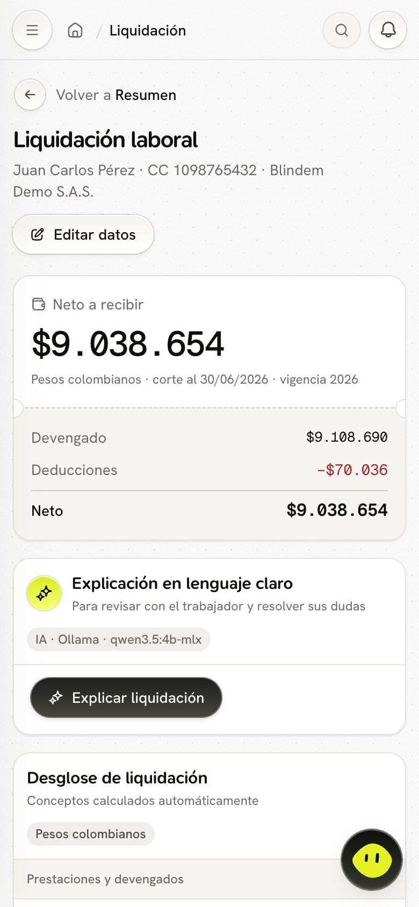
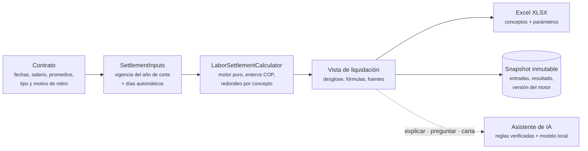
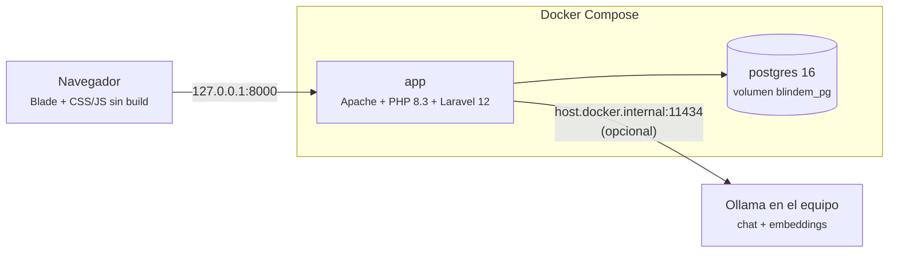

<div align="center">


# Blindem · Liquidaciones

**Gestión laboral y liquidación de contratos en Colombia, explicada concepto por concepto.**

Registra trabajadores, empresas y contratos; calcula cesantías, intereses, prima, vacaciones, indemnización y aportes con la vigencia legal de cada año; exporta a Excel y guarda cada resultado como un registro inmutable. Un asistente de IA local explica la liquidación y responde preguntas citando la norma.


[Inicio rápido](#inicio-rápido) · [Qué hace](#qué-hace) · [Cómo funciona](#cómo-funciona) · [Arquitectura](docs/ARQUITECTURA.md) · [Guía funcional](docs/FUNCIONALIDADES.md) · [Toda la documentación](docs/README.md)

<br>



</div>

---

## El problema

Liquidar un contrato laboral en Colombia suele hacerse en hojas de cálculo copiadas de un caso a otro. Eso trae errores difíciles de ver:

- **Días mal contados.** Vacaciones divididas por 720 cuando lo registrado son días de descanso, semestres de prima mal calculados, meses de 31 días.
- **Parámetros desactualizados.** El salario mínimo y el auxilio de transporte del año anterior se quedan en la plantilla.
- **Bases mezcladas.** Horas extras dentro de la base de vacaciones, aportes cobrados sobre vacaciones compensadas, indemnización sin los promedios salariales.
- **Sin trazabilidad.** Si se edita la hoja, no queda registro de qué se le entregó al trabajador ni con qué norma.

## Qué hace

Blindem Liquidaciones convierte ese proceso en un flujo guiado y auditable:

| | |
| --- | --- |
| **Registro laboral** | Trabajadores, empresas y contratos relacionados: una persona puede tener varios contratos, en una o varias empresas, con su historial. |
| **Cálculo automático** | Cesantías, intereses, prima, vacaciones compensadas, salario y auxilio pendientes, indemnización y descuentos de salud y pensión. Los días se deducen de las fechas. |
| **Vigencias por año** | Salario mínimo, auxilio de transporte y tarifas de cada año con su decreto. Sin vigencia para el año de corte, el cálculo se bloquea en vez de usar cifras equivocadas. |
| **Desglose explicado** | Cada concepto muestra su fórmula, sus días y su base. Las diferencias con la plantilla original están documentadas. |
| **Excel y historial** | Exportación XLSX con hoja de parámetros y fuentes. Cada liquidación guardada es un snapshot que no cambia aunque cambien los datos o la ley. |
| **Asistente de IA local** | Explica la liquidación en lenguaje claro, responde preguntas con normas citadas, rellena contratos desde texto libre y convierte búsquedas en filtros. Corre en el equipo con Ollama, o en modo simulado sin red. |
| **Equipo y seguridad** | Roles de administrador y colaborador, gestión de usuarios, cuentas desactivables, recuperación de contraseña, notificaciones y alertas de pendientes. |

## Qué facilita

| Para | Antes | Con Blindem |
| --- | --- | --- |
| **Quien liquida** | Copiar la plantilla, ajustar fórmulas, contar días a mano | Registrar fechas y salario; el sistema calcula días, bases y conceptos |
| **Quien revisa** | Rehacer el cálculo para encontrar el error | Ver la fórmula, la base y la fuente de cada cifra en pantalla y en el Excel |
| **El trabajador** | Recibir un total sin explicación | Recibir una explicación en lenguaje claro y una carta con las cifras exactas |
| **La empresa** | Hojas sueltas sin historial | Un registro inmutable de cada liquidación entregada, con versión del motor y norma vigente |
| **El administrador** | Actualizar decretos en cada plantilla | Registrar la vigencia del año una sola vez para todo el equipo |

Además, la app avisa lo que requiere acción: retiros sin liquidación guardada, contratos a término fijo por vencer y años sin parámetros laborales.

## Recorrido visual

<table>
  <tr>
    <td width="50%"><br><b>Liquidación.</b> Neto, devengado y deducciones; desglose con fórmula por concepto y explicación en lenguaje claro.</td>
    <td width="50%"><br><b>Contratos.</b> Filtros por estado, tipo, empresa y documento, o búsqueda en lenguaje natural.</td>
  </tr>
  <tr>
    <td><br><b>Contrato.</b> Datos, revisión previa del asistente e historial de liquidaciones guardadas.</td>
    <td><br><b>Paleta de comandos.</b> <kbd>⌘K</kbd> para ir a cualquier pantalla, buscar registros o preguntar a la IA.</td>
  </tr>
  <tr>
    <td><br><b>Modo oscuro.</b> Sigue el tema del sistema o el elegido por la persona.</td>
    <td><br><b>Acceso.</b> Inicio de sesión con recuperación de contraseña y límite de intentos.</td>
  </tr>
</table>

<p align="center"><br>Adaptada a móvil: formularios, tablas y liquidación.</p>

## Cómo funciona



1. **Registras el contrato** con fechas, salario, promedios de extras y recargos, tipo de contrato y, si terminó, el motivo de retiro.
2. **El sistema arma las entradas:** busca los parámetros laborales del año de corte y deduce los días de cesantías, prima, vacaciones y salario pendiente. Lo que escribas a mano siempre prevalece.
3. **El motor calcula** cada concepto con valores enteros en pesos. Es una clase pura, sin base de datos, probada de forma aislada.
4. **Revisas, exportas y guardas.** El snapshot guarda entradas, tarifas, fuentes, resultado y versión, y se consulta o exporta sin recalcular.
5. **El asistente explica** el resultado sin cambiar nunca una cifra: lo que dice el modelo se verifica contra el cálculo y las fuentes antes de mostrarse.

El detalle de fórmulas y decisiones jurídicas está en [reglas de cálculo](docs/REGLAS-DE-CALCULO.md).

## Inicio rápido

**Requisitos:** Docker Desktop (o Docker Engine) con Docker Compose. No hace falta PHP, Composer ni Node en el equipo.

```bash
sh scripts/setup-local.sh
```

El script crea la configuración, genera la clave sin mostrarla, construye la imagen, espera a que los servicios estén sanos y carga datos de demostración. Abre **http://127.0.0.1:8000**.

| Rol | Correo | Contraseña demo |
| --- | --- | --- |
| Administrador | `admin@blindem.test` | `Cambiar123!` |
| Colaborador | `colaborador@blindem.test` | `Cambiar123!` |

Los datos persisten en PostgreSQL. Para aplicar cambios de código:

```bash
docker compose up --build -d --wait
```

<details>
<summary><b>Sin Docker</b></summary>

Requiere PHP 8.2+, Composer 2, PostgreSQL y las extensiones `pdo_pgsql`, `zip`, `gd`, `intl`, `mbstring` y `xml`.

```bash
composer install
cp .env.example .env
php artisan key:generate
# Configura DB_HOST, DB_DATABASE, DB_USERNAME y DB_PASSWORD
php artisan migrate --seed
php artisan serve
```

</details>

<details>
<summary><b>Activar la IA con Ollama</b></summary>

Con `AI_DRIVER=simulated` (valor por defecto) el asistente responde con reglas locales, sin red. Para usar un modelo real en el equipo:

```bash
brew install ollama && brew services start ollama
```

```bash
ollama pull qwen3.5:4b-mlx && ollama pull qwen3-embedding:0.6b
```

En `.env`: `AI_DRIVER=ollama`, `OLLAMA_MODEL=qwen3.5:4b-mlx` y `OLLAMA_EMBED_MODEL=qwen3-embedding:0.6b`. Luego:

```bash
docker compose up -d --wait
```

La etiqueta «IA · Ollama · qwen3.5:4b-mlx» en la interfaz confirma el cambio. Más en [asistente de IA](docs/IA.md) e [infraestructura](docs/INFRAESTRUCTURA.md#3-ollama).

</details>

## Arquitectura en una mirada



- **Monolito Laravel** con vistas Blade y JavaScript sin empaquetador: pocas piezas, nada que compilar.
- **Motor de cálculo puro** (`LaborSettlementCalculator`), versionado y probado sin base de datos.
- **Snapshots JSON** de cada liquidación: el historial no se recalcula.
- **Todo local:** el puerto solo escucha en `127.0.0.1`; los datos laborales no salen del equipo. Ollama corre fuera de Docker para usar la GPU del Mac.
- **IA híbrida:** cada tarea tiene una respuesta por reglas; el modelo redacta y entiende texto libre, pero sus cifras y citas se verifican.

Contexto, contenedores, componentes, flujos, modelo de datos y decisiones en [ARQUITECTURA.md](docs/ARQUITECTURA.md).

## Roles y permisos

| Operación | Colaborador | Administrador |
| --- | :---: | :---: |
| Resumen, búsqueda, notificaciones y perfil | ✓ | ✓ |
| Consultar trabajadores, empresas y contratos | ✓ | ✓ |
| Crear y editar contratos y trabajadores | ✓ | ✓ |
| Calcular, exportar y guardar liquidaciones | ✓ | ✓ |
| Usar el asistente de IA | ✓ | ✓ |
| Eliminar trabajadores; crear, editar y eliminar empresas | — | ✓ |
| Parámetros laborales por año | — | ✓ |
| Catálogos: documentos, cargos, tipos de contrato y motivos de retiro | — | ✓ |
| Usuarios: crear, editar, desactivar y enviar enlace de acceso | — | ✓ |

Las acciones restringidas se validan en el servidor (middleware `admin`) y no se muestran a colaboradores. Una cuenta desactivada pierde el acceso en su siguiente petición.

## Stack

| Capa | Tecnología |
| --- | --- |
| Aplicación | Laravel 12, PHP 8.3 (8.2+), Blade |
| Base de datos | PostgreSQL 16; SQLite en memoria para pruebas rápidas |
| Frontend | CSS y JavaScript sin build; validación con zod; iconos [Hugeicons](https://hugeicons.com) en sprite local; avatar [blobatar](https://blobatar.dev) y sonidos [cuelume](https://cuelume.dev) |
| Exportación | PhpSpreadsheet (XLSX con hoja de parámetros y fuentes) |
| IA | [Ollama](https://ollama.com) local (`qwen3.5:4b-mlx`, `qwen3-embedding:0.6b`) o modo simulado; RAG propio en PHP (BM25 + embeddings) |
| Infraestructura | Docker multietapa y Docker Compose |

## Estructura

```text
app/
  Http/Controllers/        recursos, liquidación, IA, usuarios, perfil, búsqueda, notificaciones
  Http/Middleware/         EnsureAdmin, EnsureActiveUser
  Models/                  entidades Eloquent (LaborParameter: vigencias por año)
  Notifications/           avisos de actividad y alertas
  Services/
    LaborSettlementCalculator.php   motor de cálculo puro
    SettlementInputs.php            entradas del motor desde un contrato
    NotificationCenter.php          alertas de pendientes y avisos al equipo
    Ai/                             asistente, agente flotante, RAG y reglas
  Support/Table.php        orden y tamaño de página seguros para las tablas
config/ai.php              proveedor de IA, modelos y RAG
database/                  migraciones, restricciones, índices y seeders demo
docker/                    Apache, entrypoint y php.ini
docs/                      documentación, diagramas y capturas
resources/knowledge/       notas legales para el RAG (Markdown)
resources/views/           vistas Blade
public/                    CSS, JS, iconos, service worker y página sin conexión
scripts/                   setup-local, backup, verify_calculator
tests/                     PHPUnit: Unit/ y Feature/
```

## Documentación

| Documento | Contenido |
| --- | --- |
| [Guía funcional](docs/FUNCIONALIDADES.md) | Qué hace cada pantalla, flujos de trabajo y qué facilita a cada rol |
| [Arquitectura](docs/ARQUITECTURA.md) | Contexto, contenedores, componentes, flujos, modelo de datos y decisiones, con diagramas |
| [Reglas de cálculo](docs/REGLAS-DE-CALCULO.md) | Fórmulas, decisiones jurídicas, vigencias y casos de aceptación |
| [Asistente de IA](docs/IA.md) | Tareas, modo híbrido, RAG con fuentes citadas, agente flotante y configuración |
| [Infraestructura](docs/INFRAESTRUCTURA.md) | Docker, PostgreSQL y Ollama: imágenes, red, variables, backups y diagnóstico |
| [Operación local](docs/OPERACION-LOCAL.md) | Puesta en marcha, actualización, administradores, backups y pruebas |
| [Sistema de diseño](docs/design-system.md) | Tipografía, color, componentes, movimiento e iconos |

## Pruebas

```bash
docker compose exec -T app vendor/bin/phpunit
docker compose exec -T app php scripts/verify_calculator.php
```

La suite (101 pruebas) cubre el motor, el flujo de liquidación, usuarios, cuentas, búsqueda, tablas, notificaciones, el asistente y la base de conocimiento. Las pruebas de IA no llaman a ningún modelo. Para correrlas también sobre PostgreSQL:

```bash
docker compose exec -T postgres createdb -U blindem blindem_test
docker compose exec -T app vendor/bin/phpunit -c phpunit.postgres.xml
```

La clase base de pruebas aborta si la conexión no es una base de pruebas, para que nunca toque los datos reales.

## Alcance y limitaciones

- Cubre contratos laborales ordinarios del sector privado. No sustituye un sistema de nómina, la PILA ni casos especiales como salario integral, incapacidades o embargos.
- Pensada para uso local. Publicarla requiere HTTPS, proxy, secretos fuera de `.env` y copias automáticas ([detalle](docs/ARQUITECTURA.md#11-limitaciones-y-evolución)).
- Pendientes: autenticación multifactor y auditoría completa de cambios.

## Aviso legal

Proyecto de demostración técnica. Los cálculos siguen el Código Sustantivo del Trabajo y los decretos citados en [reglas de cálculo](docs/REGLAS-DE-CALCULO.md#fuentes-consultadas), pero no equivalen a asesoría legal.
