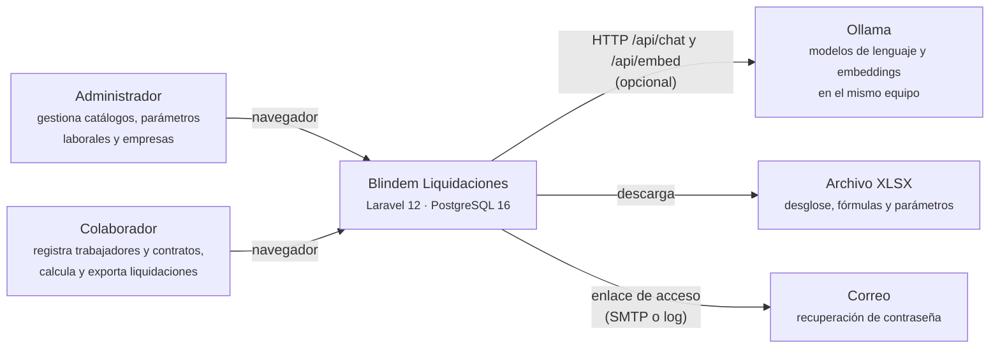
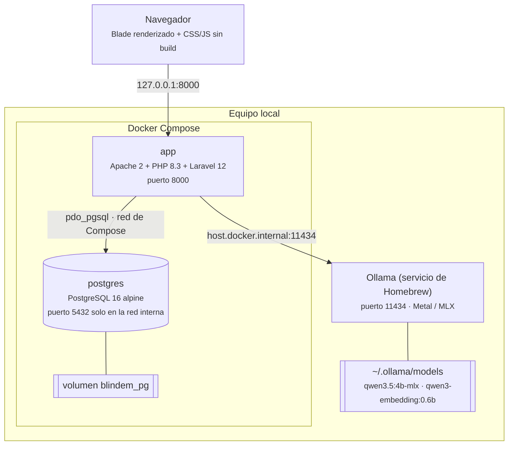
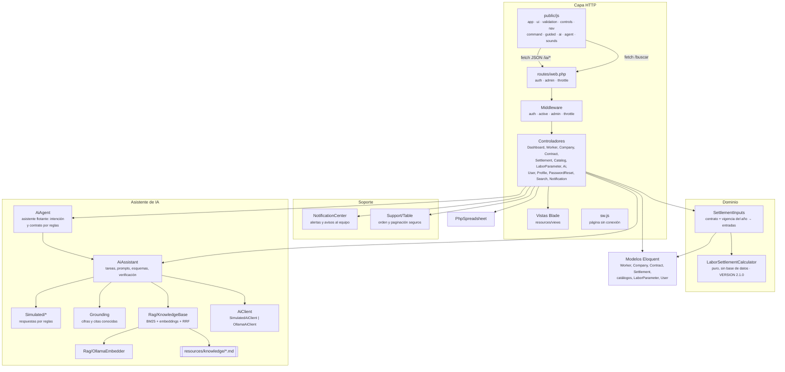
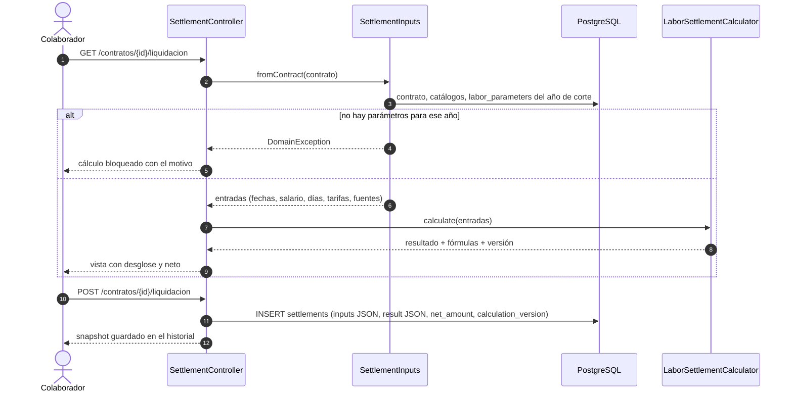
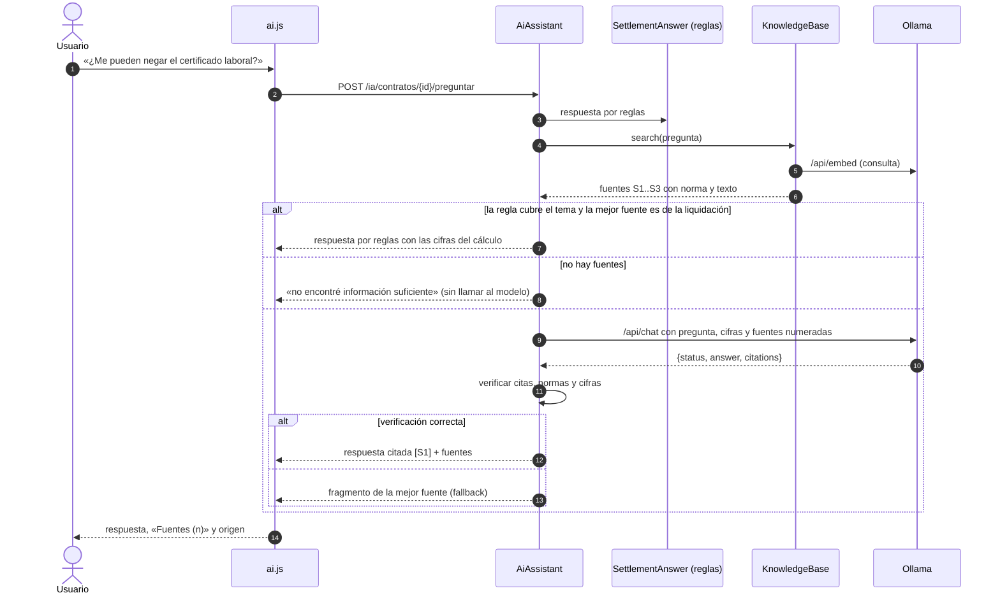
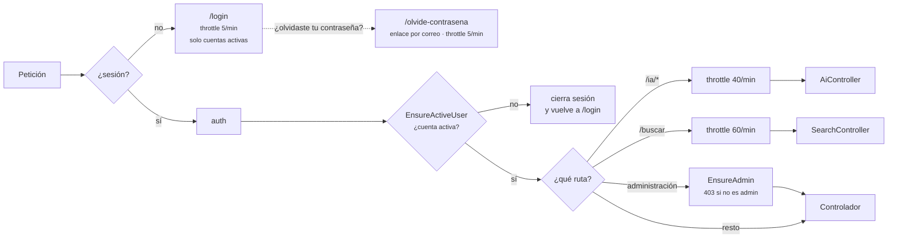
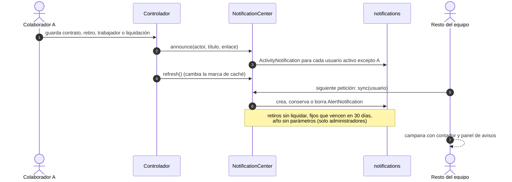
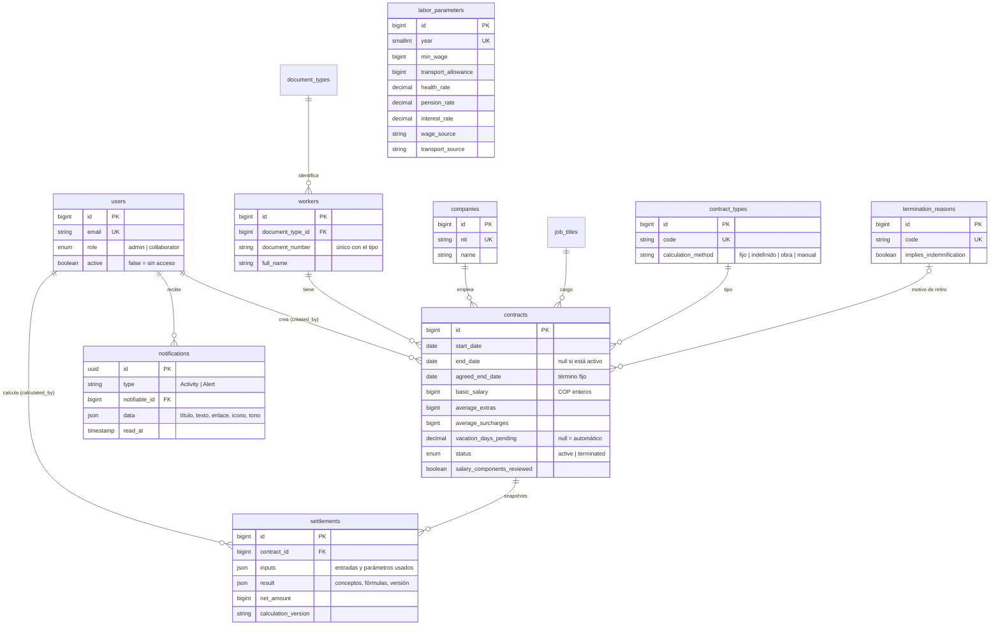
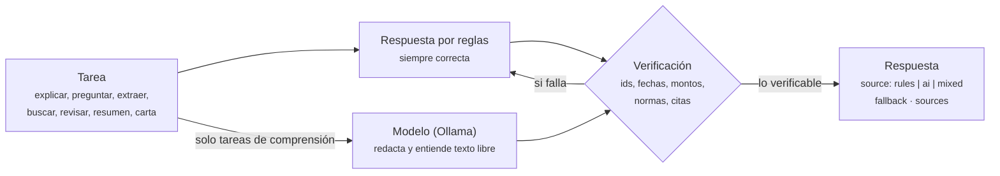
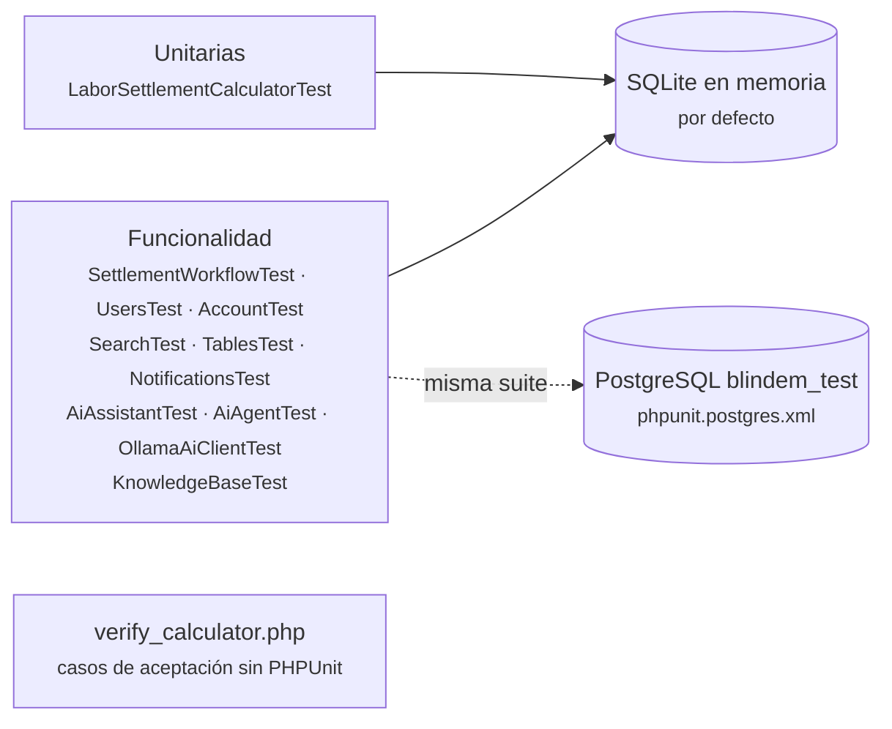

<p align="center"></p>

# Arquitectura y diseño del sistema

Blindem Liquidaciones gestiona trabajadores, empresas y contratos laborales en Colombia y calcula su liquidación: cesantías, intereses, prima, vacaciones, indemnización y aportes. Incluye un asistente de IA que explica la liquidación, responde preguntas con normas citadas, rellena contratos a partir de texto libre y convierte búsquedas en filtros.

Este documento describe cómo está construido y por qué. Los detalles de cada pieza están en:

| Documento | Contenido |
| --- | --- |
| [FUNCIONALIDADES.md](FUNCIONALIDADES.md) | Qué hace cada pantalla y qué facilita a cada rol |
| [INFRAESTRUCTURA.md](INFRAESTRUCTURA.md) | Docker, PostgreSQL y Ollama: imágenes, servicios, red, volúmenes, base de datos, modelos y diagnóstico |
| [IA.md](IA.md) | Asistente de IA: tareas, modo híbrido, RAG, verificación y configuración |
| [REGLAS-DE-CALCULO.md](REGLAS-DE-CALCULO.md) | Fórmulas, decisiones jurídicas y casos de aceptación |
| [OPERACION-LOCAL.md](OPERACION-LOCAL.md) | Puesta en marcha, actualización, backups y pruebas |
| [design-system.md](design-system.md) | Sistema visual, componentes e iconos |

## 1. Objetivos y restricciones

| Objetivo | Cómo se cumple |
| --- | --- |
| Cálculos correctos y explicables | Motor puro y determinista (`LaborSettlementCalculator`), enteros COP con redondeo HALF_UP por concepto, fórmulas y fuentes guardadas con cada resultado |
| Resultados históricos inmutables | Cada liquidación guardada es un snapshot con entradas, parámetros, resultado y versión del motor; se consulta y exporta sin recalcular |
| Funcionar sin internet | Todo corre en local con Docker; la IA usa Ollama en el mismo equipo o un modo simulado sin red |
| La IA nunca cambia una cifra ni inventa una norma | Cada tarea tiene una respuesta por reglas; lo que dice el modelo se verifica contra los datos y, si no coincide, se descarta |
| Simple de operar | Un comando (`sh scripts/setup-local.sh`), sin Node ni build de frontend, sin servicios en la nube |
| Seguro por defecto | Puerto solo en `127.0.0.1`, CSRF, roles, cuentas desactivables, límites de peticiones, pruebas bloqueadas fuera de bases de prueba |
| Que el equipo vea lo pendiente | Alertas calculadas desde los datos (retiros sin liquidar, contratos por vencer, años sin parámetros) y avisos de actividad del equipo |

Fuera de alcance: nómina completa, PILA, despliegue público, autenticación multifactor y auditoría completa de cambios.

## 2. Contexto

Quién usa el sistema y con qué se comunica.



No hay integraciones externas obligatorias. El correo usa `MAIL_MAILER=log` por defecto (el enlace queda en `storage/logs`); Ollama es opcional: con `AI_DRIVER=simulated` el asistente responde con reglas locales.

## 3. Contenedores

Las piezas que se ejecutan y cómo se conectan.



| Contenedor | Responsabilidad | Estado |
| --- | --- | --- |
| `app` | Rutas, autenticación, validación, motor de cálculo, exportación XLSX, asistente de IA | Sin estado propio: el código se monta desde el repositorio y la caché de archivos es regenerable |
| `postgres` | Datos de negocio, snapshots de liquidaciones, sesiones | Persistente en el volumen `blindem_pg` |
| Ollama | Inferencia del modelo de chat y de embeddings | Fuera de Docker, para usar la GPU del Mac (Metal/MLX); los modelos viven en `~/.ollama` |

Ollama corre fuera de Docker a propósito: Docker Desktop en macOS no expone la GPU de Apple, y un modelo en CPU dentro de un contenedor es varias veces más lento.

## 4. Componentes de la aplicación



Reglas de dependencia:

- El motor de cálculo no conoce Laravel ni la base de datos: recibe un arreglo y devuelve otro. Por eso se prueba de forma aislada (`tests/Unit/LaborSettlementCalculatorTest.php` y `scripts/verify_calculator.php`).
- `AiAssistant` solo habla con el proveedor a través de la interfaz `AiClient::run()`. Cambiar de Ollama a otro proveedor no toca las tareas.
- Las respuestas por reglas (`Simulated/*`) son a la vez el modo sin red y la referencia verificada del modo con modelo.
- `AiAgent` no tiene lógica de negocio propia: decide la intención y el contrato y delega en las tareas de `AiAssistant`.
- Los controladores avisan a `NotificationCenter` cuando cambian datos que alimentan las alertas; las alertas se recalculan desde la base, no se guardan como estado independiente.
- El JavaScript es progresivo: sin él, los formularios, enlaces y tablas siguen funcionando con su comportamiento nativo.

### Estructura de carpetas

```text
app/
  Http/Controllers/          un controlador por recurso + Ai, User, Profile, PasswordReset, Search, Notification
  Http/Middleware/           EnsureAdmin, EnsureActiveUser
  Models/                    entidades Eloquent
  Notifications/             ActivityNotification (avisos) y AlertNotification (pendientes)
  Providers/                 elige el proveedor de IA y arma la base de conocimiento
  Services/
    LaborSettlementCalculator.php   motor de cálculo puro
    SettlementInputs.php            entradas del motor desde un contrato
    NotificationCenter.php          alertas de pendientes y avisos al equipo
    Ai/                             asistente: AiAssistant, AiAgent, clientes, Grounding
      Rag/                          KnowledgeBase, Embedder, OllamaEmbedder
      Simulated/                    respuestas por reglas de cada tarea
  Support/Table.php          orden por columnas permitidas y tamaño de página
config/ai.php                proveedor, modelo, RAG
routes/console.php           blindem:admin (crear administrador sin datos demo)
database/migrations/         esquema, restricciones e índices
database/seeders/            catálogos, usuarios y datos de demostración
docker/                      Apache, entrypoint y php.ini de producción
resources/knowledge/         notas legales para el RAG (Markdown)
resources/views/             Blade
public/css, public/js        estilos e interacciones sin build (vendor/: zod, blobatar, cuelume)
public/icons/                sprite de Hugeicons
public/sw.js, offline.html   página de respaldo cuando no hay conexión
scripts/                     setup-local, backup, verify_calculator
tests/                       PHPUnit (unitarias y de funcionalidad)
```

## 5. Flujos principales

### 5.1 Calcular y guardar una liquidación



El snapshot guarda entradas y resultado completos. Si mañana cambian los parámetros del año, el contrato o la versión del motor, la liquidación guardada se sigue mostrando y exportando igual.

### 5.2 Pregunta al asistente con fuentes (RAG)



### 5.3 Autenticación, cuentas y permisos



- Las sesiones se guardan en la tabla `sessions` de PostgreSQL, así que sobreviven a recrear el contenedor `app`. Desde **Perfil y seguridad** cada persona ve sus sesiones abiertas, las cierra y cambia su contraseña (al cambiarla se renueva el `remember_token`).
- El administrador gestiona **usuarios**: los crea, cambia su rol, los desactiva y les envía un enlace para definir contraseña. Una cuenta desactivada no puede iniciar sesión y pierde el acceso en su siguiente petición aunque conserve la cookie.
- Los formularios llevan token CSRF y las validaciones se hacen en el servidor (el cliente valida con zod a partir de los mismos atributos HTML). `Gate::before` concede todo al rol `admin`.

### 5.4 Notificaciones y pendientes



Cada alerta tiene un id estable derivado de su causa: se crea una vez, conserva su estado de lectura y desaparece sola cuando el trabajo se hace (por ejemplo, al guardar la liquidación). `sync` corre como máximo una vez por minuto por usuario, salvo que los datos cambien.

### 5.5 Navegación y búsqueda

- **Paleta de comandos** (`⌘K` / `Ctrl+K`, `command.js`): ir a cualquier pantalla, ejecutar acciones, buscar contratos, trabajadores y empresas (`GET /buscar`) o pasar la pregunta al asistente. `?` muestra los atajos (`G` + letra para navegar).
- **Tablas** con orden por columna y tamaño de página (`Support/Table`): solo se ordena por claves permitidas, así que la URL nunca llega a una columna arbitraria.
- **Formularios guiados** (`guided.js`): el asistente pregunta un dato a la vez y llena el formulario real; el formulario clásico está a un clic.
- **Sin conexión:** `sw.js` solo guarda la página `offline.html` y sus recursos; las páginas de la aplicación siempre vienen de la red, para no mostrar datos laborales viejos.

## 6. Modelo de datos



Decisiones del modelo:

- **Dinero en enteros.** Los montos son `bigint` en pesos, sin decimales: no hay errores de coma flotante y el redondeo HALF_UP se aplica una sola vez por concepto.
- **Integridad referencial estricta.** Los catálogos usan `restrictOnDelete`: no se puede borrar un cargo, una empresa o un tipo en uso. Un contrato con liquidaciones guardadas tampoco se puede eliminar.
- **Vigencias por año.** `labor_parameters` tiene una fila por año con su fuente legal. Un contrato que termina en un año sin parámetros no se calcula, en lugar de usar los del año actual en silencio.
- **Snapshots en JSON.** `settlements.inputs` y `settlements.result` son JSON porque el resultado evoluciona con la versión del motor; `net_amount` va en columna propia para ordenar y sumar.
- **Notificaciones nativas de Laravel.** La tabla `notifications` guarda avisos y alertas; `password_reset_tokens` guarda los enlaces de recuperación con caducidad.
- **Índices.** Cada clave foránea tiene índice (migración `2026_11_01_000001_index_foreign_keys`), además de `contracts(status, start_date)` para el listado y `settlements(contract_id, id)` para el historial.

## 7. Asistente de IA

Resumen; el detalle está en [IA.md](IA.md).



| Tarea | Proveedor |
| --- | --- |
| Revisión del contrato, «Para revisar hoy», carta | Solo reglas: son cumplimiento legal o documentos con cifras exactas |
| Explicación de la liquidación | El modelo reescribe la explicación por reglas; cada `$` debe ser una cifra del cálculo |
| Preguntas | Reglas si el tema es de la liquidación; si no, RAG con fuentes citadas |
| Rellenar contrato y búsqueda | Reglas + aportes del modelo que aparezcan en el texto o en los catálogos |

## 8. Atributos de calidad

| Atributo | Decisión | Medida |
| --- | --- | --- |
| Corrección | Motor puro con pruebas unitarias y casos de aceptación; IA verificada contra los datos | 16 pruebas del motor; `verify_calculator.php` |
| Rendimiento | Sin build ni SPA; consultas con índices y `withCount`; RAG con embeddings en caché | Búsqueda de fuentes ~40 ms; pregunta con fuentes 4–9 s con `qwen3.5:4b-mlx` en un M2 |
| Disponibilidad de la IA | Si Ollama falla, la interfaz muestra el motivo y permite reintentar; los embeddings caen a BM25 | Las funciones de cálculo nunca dependen de la IA |
| Seguridad | Puerto local, CSRF, roles, throttle, credenciales fuera de Git, pruebas bloqueadas fuera de `blindem_test` | Usuario `www-data` en la imagen de producción |
| Mantenibilidad | Proveedor de IA detrás de una interfaz; conocimiento legal en Markdown; sin dependencias de frontend | Agregar una norma es agregar un archivo y una pregunta de prueba |
| Portabilidad | Docker Compose; `host-gateway` para llegar a Ollama también en Linux | Mismo comando en macOS y Linux |

## 9. Decisiones de arquitectura

| # | Decisión | Alternativas | Motivo |
| --- | --- | --- | --- |
| 1 | Monolito Laravel con Blade, sin SPA | React/Vue + API | Pocos usuarios, formularios y tablas; menos piezas y sin build |
| 2 | Motor de cálculo como clase pura | Cálculo en modelos o en SQL | Pruebas aisladas, resultados reproducibles y versionados |
| 3 | Snapshots JSON de cada liquidación | Recalcular al consultar | Un cambio de norma o de datos no debe alterar una liquidación ya entregada |
| 4 | PostgreSQL 16 | MySQL, SQLite | JSON nativo, restricciones e índices sólidos; SQLite queda para pruebas rápidas |
| 5 | Ollama local con modelos pequeños | API en la nube | Datos laborales sensibles no salen del equipo; funciona sin internet |
| 6 | Modo híbrido reglas + modelo | Solo modelo | Un modelo de 4B inventa cifras y normas; las reglas garantizan la corrección |
| 7 | RAG en PHP (BM25 + embeddings + RRF) sin base vectorial | LangChain, pgvector, Chroma | Unas 20 notas caben en memoria; sin servicios extra; la búsqueda tarda ~40 ms |
| 8 | Ollama fuera de Docker | Contenedor de Ollama | Acceso a la GPU de Apple (Metal/MLX) |
| 9 | Iconos Hugeicons en un sprite SVG local | CDN o paquete JS | Sin red ni build; licencia MIT incluida |

## 10. Pruebas



- La suite tiene 101 pruebas. Además del motor y la liquidación cubre permisos por rol, cuentas desactivadas, recuperación de contraseña, sesiones, búsqueda, orden de tablas y el ciclo de vida de las alertas.
- Las pruebas de IA no llaman a ningún modelo: usan el modo simulado o `Http::fake`. `OllamaAiClientTest` cubre la verificación, los respaldos, el reintento sin `format` y los errores de conexión.
- `KnowledgeBaseTest` mide la recuperación: 12 preguntas de referencia deben traer su nota en primer lugar (recall@1) y las preguntas ajenas no deben traer fuentes.
- `tests/TestCase.php` aborta si la conexión no es SQLite en memoria o `blindem_test` con `APP_ENV=testing`, para que una prueba nunca borre la base real.

## 11. Limitaciones y evolución

- **Un solo equipo.** El diseño asume uso local. Para publicarlo hace falta HTTPS, un proxy, la imagen `production` (ya existe en el `Dockerfile`), secretos fuera de `.env` y copias de seguridad automáticas.
- **Modelo pequeño.** `qwen3.5:4b-mlx` responde rápido pero a veces resume de más; las respuestas muestran sus fuentes para que se puedan revisar. Un modelo de 7–9B o uno en Ollama Cloud mejora la redacción sin cambiar código.
- **Base de conocimiento curada a mano.** Las notas están revisadas a noviembre de 2026. Si crecen a cientos de documentos, conviene pasar los embeddings a `pgvector` y agregar un reranker.
- **Pendientes de seguridad.** Autenticación multifactor y auditoría completa de cambios. La recuperación de contraseña ya existe, pero necesita un SMTP real (`MAIL_MAILER=smtp`) para enviar correos fuera del log.
