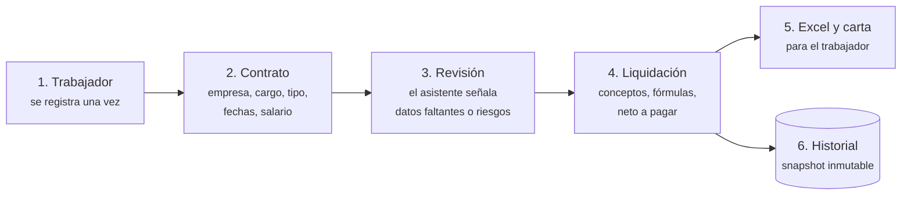
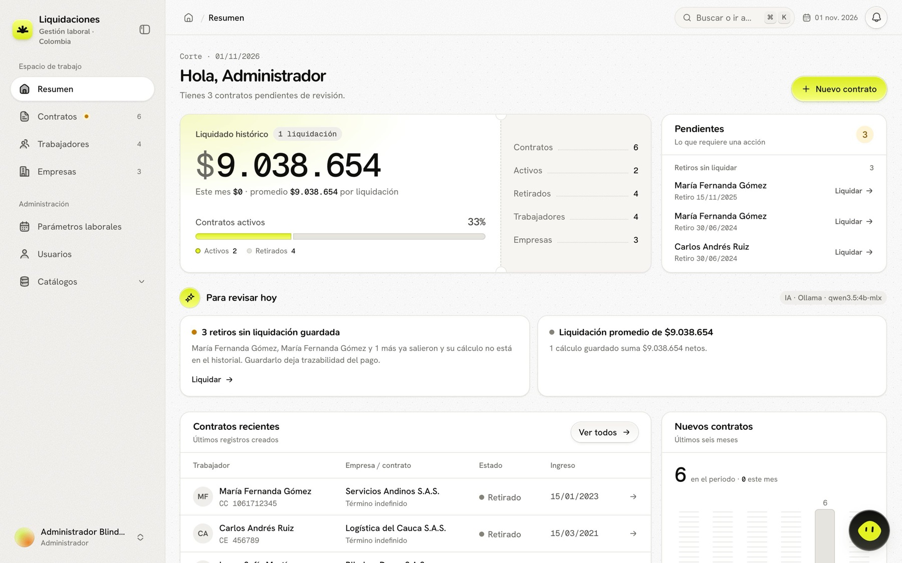
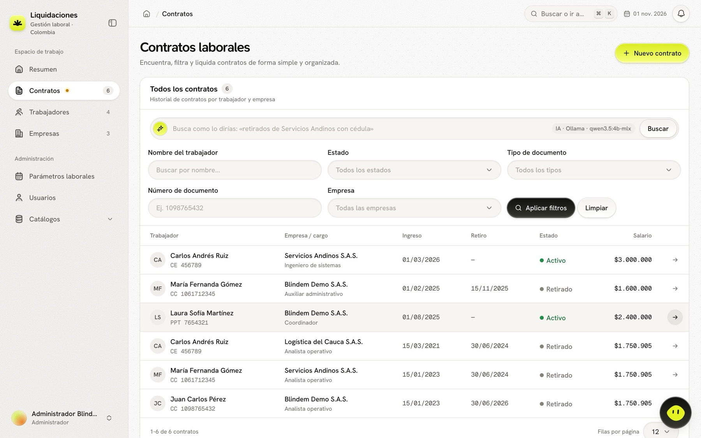
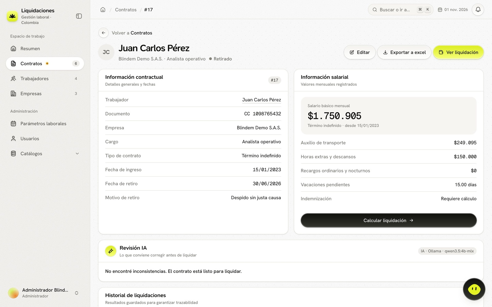
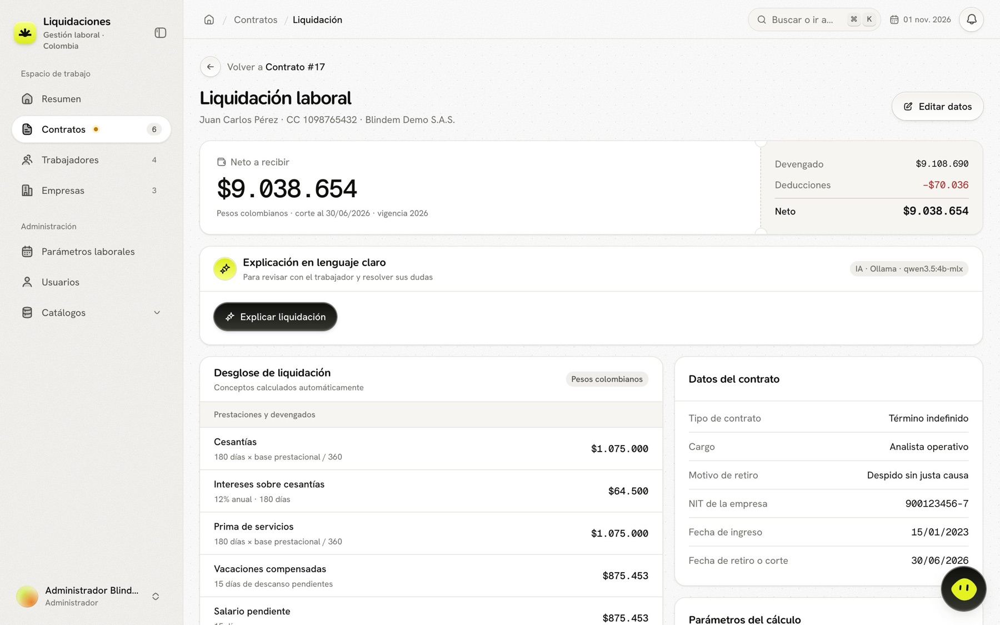

# Guía funcional

Qué hace Blindem Liquidaciones, pantalla por pantalla, y qué le facilita a cada persona del equipo. Para saber cómo está construido, consulta [ARQUITECTURA.md](ARQUITECTURA.md); para las fórmulas, [REGLAS-DE-CALCULO.md](REGLAS-DE-CALCULO.md).

## En una frase

Registras un contrato con sus fechas y su salario, y la aplicación calcula la liquidación completa con la norma del año, la explica, la exporta a Excel y la guarda tal como se entregó.

## Quién la usa

| Rol | Qué hace en la app | Qué gana |
| --- | --- | --- |
| **Colaborador** (analista de nómina o talento humano) | Registra trabajadores y contratos, calcula, explica, exporta y guarda liquidaciones | Deja de contar días y copiar plantillas; cada cifra trae su fórmula |
| **Administrador** | Todo lo anterior, más empresas, catálogos, parámetros laborales por año y usuarios | Actualiza el salario mínimo y el auxilio una sola vez para todo el equipo; controla quién tiene acceso |
| **Trabajador** (no usa la app) | Recibe la liquidación, el Excel y una carta | Entiende cada concepto en lenguaje claro |

## Flujo de trabajo típico

1. **Registra al trabajador** (o hazlo desde el mismo formulario del contrato con «Registrar nuevo»).
2. **Crea el contrato.** Puedes pegar un correo o una carta y el asistente rellena los campos que encuentre.
3. **Revisa.** En el detalle del contrato, el asistente señala con severidad alta, media o baja lo que conviene corregir antes de liquidar.
4. **Abre la liquidación.** Cada concepto muestra días, base y fórmula. Los días que dejaste en blanco se calculan a partir de las fechas.
5. **Exporta y comparte.** Descarga el XLSX o genera un borrador de carta de liquidación o de paz y salvo.
6. **Guarda.** El resultado queda en el historial con sus entradas, tarifas, fuentes y versión del motor.

## Pantallas

### Resumen

- **Liquidado histórico:** total neto guardado, lo liquidado este mes y el promedio por liquidación.
- **Contadores:** contratos, activos, retirados, trabajadores y empresas, con la proporción de activos.
- **Pendientes:** retiros que todavía no tienen una liquidación guardada, con acceso directo a «Liquidar».
- **Para revisar hoy:** el asistente lista contratos a término fijo por vencer (preaviso de 30 días), salarios por debajo del mínimo, retiros sin liquidar y contratos sin revisar.
- **Contratos recientes** y **nuevos contratos de los últimos seis meses**.

### Contratos

- Filtros por estado, tipo de contrato, empresa, tipo y número de documento. Tablas ordenables y con tamaño de página.
- **Búsqueda en lenguaje natural:** «contratos retirados de Logística del Cauca» se convierte en filtros reales, que se pueden ajustar.
- **Formulario:** trabajador, empresa, cargo, tipo, fechas (ingreso, retiro y finalización pactada), estado y motivo de retiro, salario básico, auxilio de transporte, promedios de horas extras y de recargos (por separado), días de cada concepto, indemnización manual opcional, préstamos y otras deducciones.
- **Días automáticos:** los campos de días pueden quedar en blanco. El formulario muestra al lado el valor que se usará; si escribes uno (incluido 0), ese prevalece.
- **Modo guiado:** el asistente pregunta un dato a la vez y llena el formulario real; el formulario clásico está a un clic.

### Detalle de contrato

Información contractual y salarial, revisión del asistente antes de liquidar e historial de liquidaciones guardadas. Un contrato con liquidaciones guardadas no se puede eliminar.

### Liquidación

- **Neto a recibir** con devengado y deducciones, fecha de corte y vigencia usada.
- **Desglose:** cesantías, intereses, prima, vacaciones compensadas, salario y auxilio pendientes, indemnización, salud, pensión y otras deducciones. Cada línea muestra su fórmula y sus días, e indica cuáles fueron automáticos.
- **Parámetros del cálculo:** salario mínimo, auxilio, tarifas y decretos del año de corte.
- **Explicación en lenguaje claro** y **preguntas de seguimiento** («¿por qué me descuentan salud?», «¿me pueden negar el certificado laboral?») con las normas citadas.
- **Carta:** borrador de liquidación o de paz y salvo con las cifras exactas del cálculo.
- **Exportar** a Excel: hoja «Liquidación» con los conceptos y hoja «Parámetros y fuentes».
- **Guardar** en el historial. Una liquidación guardada se abre y exporta igual aunque después cambien el contrato, los parámetros o el motor.

Si el año de corte no tiene parámetros laborales, la pantalla explica el motivo y no calcula.

### Trabajadores y empresas

- **Trabajador:** tipo y número de documento (únicos en conjunto), datos personales e historial de contratos en una o varias empresas.
- **Empresa:** NIT único y nombre; se elige al crear cada contrato. Crear, editar y eliminar empresas es tarea del administrador.

### Administración

| Pantalla | Para qué sirve |
| --- | --- |
| **Parámetros laborales** | Una vigencia por año: salario mínimo, auxilio de transporte, tarifas de salud, pensión e intereses, y el decreto de cada valor. Vienen 2023 a 2026; el administrador agrega las siguientes. |
| **Catálogos** | Tipos de documento, cargos, tipos de contrato (con su método de indemnización) y motivos de retiro (con la marca de si implican indemnización). No se puede borrar un registro en uso. |
| **Usuarios** | Crear cuentas, asignar rol, desactivar o reactivar el acceso y enviar un enlace para definir contraseña. |

### Cuenta

- **Perfil y seguridad:** datos personales, cambio de contraseña y sesiones activas, con opción de cerrar las demás.
- **Recuperar contraseña:** desde el inicio de sesión se pide un enlace por correo con caducidad.
- **Notificaciones:** la campana muestra avisos del equipo (nuevo contrato, retiro registrado, liquidación guardada) y alertas de trabajo pendiente, que desaparecen solas cuando se resuelven.

## Ayudas en toda la aplicación

| Ayuda | Cómo se usa |
| --- | --- |
| **Paleta de comandos** | <kbd>⌘K</kbd> / <kbd>Ctrl+K</kbd>: ir a una pantalla, buscar contratos, personas o empresas, o preguntar a la IA. <kbd>?</kbd> muestra los atajos; <kbd>G</kbd> + letra navega (por ejemplo <kbd>G</kbd> <kbd>C</kbd> para contratos). |
| **Asistente flotante** | El botón de la esquina inferior derecha o <kbd>⌘J</kbd> / <kbd>Ctrl+J</kbd>. Entiende «revisa este contrato», «explica la liquidación de Laura» o «¿qué hay pendiente hoy?», muestra los pasos que dio y pregunta cuando hay ambigüedad (por ejemplo, dos personas con el mismo nombre). |
| **Modo oscuro** | Sigue el tema del sistema o el que elijas. |
| **Móvil** | Formularios, tablas y liquidación se adaptan a pantallas pequeñas. |
| **Sin conexión** | Si se cae la red, aparece una página propia en lugar del error del navegador. |
| **Sonidos** | Sonidos suaves de interacción, que se apagan desde la barra lateral. |

## Lo que el asistente de IA hace y no hace

| Hace | No hace |
| --- | --- |
| Explica la liquidación con las cifras del cálculo | Cambiar o inventar una cifra: todo `$` que escribe se compara con el resultado |
| Responde preguntas laborales citando la norma (CST, decretos, jurisprudencia) | Responder sin fuente: si no encuentra información suficiente, lo dice |
| Rellena un contrato desde texto libre | Guardar nada por su cuenta: llena el formulario y tú confirmas |
| Convierte búsquedas en filtros | Saltarse los permisos del usuario |
| Funciona sin internet, con Ollama en el equipo o en modo simulado | Enviar datos laborales a servicios externos |

Detalle técnico en [IA.md](IA.md).

## Qué facilita, en resumen

- **Menos errores:** días, bases y vigencias se calculan con reglas probadas, no se copian de un caso anterior.
- **Menos tiempo:** el cálculo completo aparece al guardar el contrato; el Excel y la carta salen con un clic.
- **Más confianza:** cada cifra muestra su fórmula y su fuente; las diferencias con la plantilla original están documentadas.
- **Trazabilidad:** cada liquidación entregada queda guardada tal como se calculó, con la versión del motor.
- **Coordinación:** el equipo ve lo pendiente y lo que hicieron los demás sin preguntarlo.
- **Privacidad:** todo corre en el equipo; ni los datos ni las preguntas a la IA salen a la nube.

## Datos de demostración

`scripts/setup-local.sh` carga seis contratos de ejemplo (indefinido con despido sin justa causa, los dos casos de la plantilla Excel, un activo con vacaciones disfrutadas, un término fijo terminado antes del plazo y una obra o labor activa).
