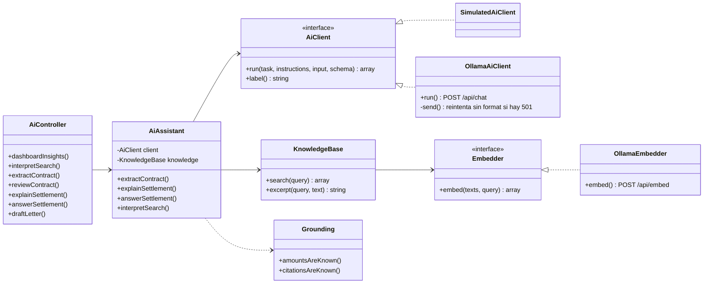
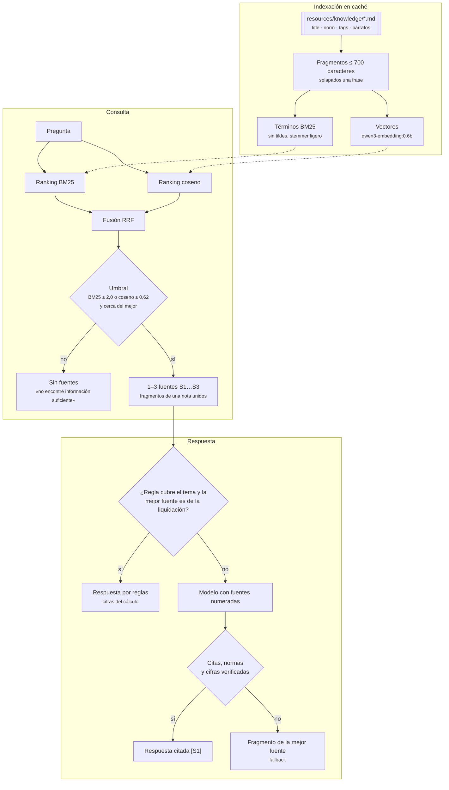

<p align="center"></p>

# Asistente de IA

Este documento explica el asistente: qué tareas resuelve, cómo combina reglas y modelo, cómo funciona la recuperación de normas (RAG) y cómo se configura. La arquitectura general está en [ARQUITECTURA.md](ARQUITECTURA.md) y la instalación de Ollama y los modelos en [INFRAESTRUCTURA.md](INFRAESTRUCTURA.md#3-ollama).

El asistente funciona con dos proveedores, que se eligen con `AI_DRIVER`:

- `simulated` (valor por defecto): reglas locales y deterministas, sin red. La interfaz muestra «IA · Simulado».
- `ollama`: un servidor Ollama local o Ollama Cloud. La interfaz muestra «IA · Ollama · modelo» o «IA · Ollama Cloud · modelo».

## Dónde aparece

| Pantalla | Función | Tarea | Ruta |
| --- | --- | --- | --- |
| Resumen | «Para revisar hoy»: contratos a término fijo por vencer (preaviso de 30 días), salarios bajo el mínimo, retiros sin liquidación guardada, contratos sin revisar | `dashboard.insights` | `GET /ia/resumen` |
| Contratos | Búsqueda en lenguaje natural convertida en filtros | `contracts.search` | `POST /ia/contratos/buscar` |
| Formulario de contrato | Pegar un correo, una carta o unas notas y rellenar los campos | `contract.extract` | `POST /ia/contratos/extraer` |
| Detalle de contrato | Revisión previa a la liquidación, con severidad alta, media o baja | `contract.review` | `GET /ia/contratos/{id}/revision` |
| Liquidación | Explicación en lenguaje claro y preguntas de seguimiento, con fuentes legales citadas (RAG) | `settlement.explain`, `settlement.answer` | `GET …/explicacion`, `POST …/preguntar` |
| Liquidación | Borrador de carta al trabajador o de paz y salvo | `settlement.letter` | `POST …/carta` |
| Nuevo contrato, trabajador o empresa | Conversación guiada: el asistente pregunta un dato a la vez y llena el formulario real (`guided.js`, preguntas en los atributos `data-ask*` de cada campo). En contratos empieza con texto libre y usa `contract.extract` para no preguntar lo que ya encontró | `contract.extract` (solo contratos) | `POST /ia/contratos/extraer` |
| Todas | Paleta de comandos (⌘K / Ctrl+K): navegación, acciones, búsqueda de registros y «Preguntar» al asistente flotante; `?` muestra los atajos | — | `GET /buscar` |
| Todas | Asistente flotante: un chat que usa las tareas anteriores según lo que se pida y la pantalla abierta | — (enruta a las de arriba, y `knowledge.answer` para preguntas sin contrato) | `POST /ia/agente` |

Las rutas de liquidación aceptan `?settlement={id}` para trabajar sobre un cálculo guardado del mismo contrato. Todas exigen sesión y tienen un límite de 40 peticiones por minuto.

## Arquitectura



`AppServiceProvider` elige la implementación según `AI_DRIVER` y solo crea `OllamaEmbedder` cuando el proveedor es Ollama y `OLLAMA_EMBED_MODEL` tiene valor.

- `AiAssistant` (`app/Services/Ai/AiAssistant.php`) reúne los datos de la base de datos, redacta las instrucciones de cada tarea, define su JSON Schema y normaliza la respuesta.
- `AiClient::run(string $task, string $instructions, array $input, array $schema = []): array` es el único punto de contacto con el proveedor.
- La respuesta HTTP siempre tiene la forma `{ data, meta: { provider, ms } }`. Los errores devuelven `{ message }` con código 422 (por ejemplo, un cálculo bloqueado) o 503 (Ollama apagado, modelo ausente, clave inválida o salida que no es JSON).

### Contrato de respuesta

Cada tarea devuelve sus propios campos más estos, que la interfaz usa para decir de dónde viene la respuesta:

| Campo | Valores | Significado |
| --- | --- | --- |
| `source` | `rules`, `ai`, `mixed` | Solo reglas, redactado por el modelo y verificado, o reglas con aportes del modelo marcados «IA» |
| `fallback` | `true` / `false` | El modelo respondió algo que no pasó la verificación y se muestra la versión por reglas |
| `status` (preguntas) | `answered`, `insufficient` | Hubo evidencia suficiente o no |
| `sources` (preguntas) | lista de `{ id, title, norm, excerpt }` | Fuentes citadas en la respuesta como `[S1]`, `[S2]`… |

Ejemplo de `POST /ia/contratos/{id}/preguntar`:

```json
{
  "data": {
    "answer": "No, el empleador no puede negarse a expedirle el certificado laboral ni condicionarlo a que firme un paz y salvo [S1].",
    "status": "answered",
    "source": "ai",
    "fallback": false,
    "sources": [
      { "id": "S1", "title": "Certificado laboral", "norm": "Art. 57, numeral 7 CST", "excerpt": "Al terminar el contrato, el empleador debe dar al trabajador…" }
    ],
    "followups": ["¿Cómo se calculan las cesantías?", "¿Qué descuentos se aplican?"]
  },
  "meta": { "provider": "Ollama · qwen3.5:4b-mlx", "ms": 4012 }
}
```

## Usar Ollama

Las variables se definen en el `.env` de la raíz del proyecto; Docker Compose las pasa al contenedor. Después de cambiarlas, ejecuta `docker compose up -d --wait`.

### Local

1. Instala Ollama (https://ollama.com/download) y descarga el modelo de chat y el de embeddings:

   ```bash
   ollama pull qwen3.5:4b-mlx
   ```

   ```bash
   ollama pull qwen3-embedding:0.6b
   ```

2. Configura `.env`:

   ```dotenv
   AI_DRIVER=ollama
   OLLAMA_MODEL=qwen3.5:4b-mlx
   OLLAMA_EMBED_MODEL=qwen3-embedding:0.6b
   ```

   Dentro de Docker la URL por defecto es `http://host.docker.internal:11434`, que apunta al Ollama de tu equipo. Si ejecutas la app sin Docker, usa `OLLAMA_BASE_URL=http://localhost:11434`.

### Cloud

1. Crea una clave en https://ollama.com/settings/keys.
2. Configura `.env`:

   ```dotenv
   AI_DRIVER=ollama
   OLLAMA_BASE_URL=https://ollama.com
   OLLAMA_API_KEY=tu-clave
   OLLAMA_MODEL=gpt-oss:120b
   ```

### Modelos y tiempos

- Cada tarea envía su JSON Schema en `format`, así que el modelo responde con salida estructurada. Los modelos que no la admiten (`qwen3.5` en Ollama responde 501 «structured output is unavailable») reciben el esquema dentro del prompt; la respuesta se valida igual.
- `qwen3.5:4b-mlx` (4 GB) usa el motor MLX de Apple Silicon y es el recomendado en un Mac: responde una pregunta con fuentes en 4–9 s. `OLLAMA_THINK=false` (por defecto) apaga el razonamiento, que en este modelo multiplica el tiempo sin mejorar respuestas que de todas formas se verifican. En Intel o Linux usa `qwen2.5:7b` o `llama3.2`.
- `OLLAMA_TIMEOUT` (120 s por defecto) limita cada petición; la app amplía el límite de PHP en consecuencia. La primera llamada a un modelo local tarda más mientras se carga en memoria.
- `OLLAMA_TEMPERATURE` (0,2 por defecto) mantiene las respuestas estables. `OLLAMA_NUM_CTX` (8192) es la ventana de contexto y `OLLAMA_MAX_TOKENS` (1200) el largo máximo de cada respuesta.

### Modo híbrido: reglas verificadas + modelo

Un modelo pequeño inventa cifras y normas con facilidad. En la prueba con `llama3.2`, sin controles, dijo que la liquidación se paga «dentro de 15 días, art. 12» (es el mismo día, art. 65 CST) y calculó un neto que no existía. Por eso cada tarea tiene una respuesta por reglas, siempre correcta, y el modelo trabaja sobre ella:

| Tarea | Con Ollama | Verificación |
| --- | --- | --- |
| Rellenar contrato | Reglas + campos que el modelo encuentre | Solo se aceptan ids de los catálogos y fechas o montos que aparezcan escritos en el texto; las reglas tienen prioridad |
| Explicación | El modelo reescribe la explicación de reglas | Cada `$` debe ser una cifra del cálculo y no puede citar normas nuevas; si falla, se usa la de reglas |
| Preguntas | Reglas si el tema es de la liquidación; si no, el modelo responde con fuentes recuperadas (RAG) | Citas de fuentes recuperadas, normas que aparezcan en ellas y cifras del cálculo; si falla, el fragmento de la norma |
| Búsqueda | Reglas + filtros del modelo | Cada filtro debe estar mencionado en la búsqueda; los nombres deben ser de trabajadores registrados |
| Revisión, «Para revisar hoy», carta | Solo reglas, sin llamar al modelo | Son cumplimiento legal y documentos con cifras exactas |

Cada respuesta incluye `source` (`rules`, `ai` o `mixed`) y `fallback`. La interfaz lo muestra bajo el resultado: «verificado contra las cifras del cálculo», «combina reglas y aportes del modelo» (con la etiqueta «IA») o «el modelo dio datos que no coinciden; se muestra la versión verificada».

Si Ollama no responde, falta el modelo, la clave es inválida o la salida no es JSON, la interfaz muestra el motivo (por ejemplo «Descárgalo con «ollama pull llama3.2»») y un botón para reintentar.

## Asistente flotante

El botón con el blob de la esquina inferior derecha (o `⌘J` / `Ctrl+J`) abre un chat disponible en todas las pantallas. No es un modelo que decide qué hacer: `AiAgent` (`app/Services/Ai/AiAgent.php`) lee el mensaje con reglas, deduce la intención y el contrato, y llama a la misma tarea de `AiAssistant` que usan las tarjetas, con la misma verificación.

```text
mensaje + contexto de la pantalla ─▶ intención (reglas) ─▶ ¿de qué contrato? ─▶ tarea de AiAssistant ─▶ pasos + respuesta + ánimo
```

- **Intenciones:** ayuda, pendientes de hoy (`dashboardInsights`), buscar contratos (`interpretSearch` y luego la consulta real, con enlace a la lista filtrada), revisar un contrato (`reviewContract`), explicar una liquidación (`explainSettlement`), abrir una pantalla (devuelve el enlace) y preguntas laborales (`answerSettlement` si hay contrato; si no, `answerQuestion`, que responde solo con la base de conocimiento).
- **Contrato:** en este orden, la opción que el usuario acaba de elegir, «contrato 12», un trabajador nombrado (por partes del nombre o por número de documento), el contrato de la pantalla y el de la conversación. El layout envía la ruta y los modelos de la URL (`partials/agent.blade.php`), así que «revisa este contrato» funciona sin escribir el nombre.
- **Pregunta en lugar de adivinar:** si el nombre coincide con varios trabajadores («Carlos») o el trabajador tiene varios contratos, responde con opciones (`choices`); al elegir una, el mismo mensaje se reenvía con `chosen_worker` o `chosen_contract`. Si no hay contrato, pide el nombre.
- **Pasos:** cada respuesta trae `steps` («Entendí la petición», «Busqué el contrato», «Revisé el contrato · 2 hallazgos»). Son lo que el servidor hizo de verdad; el panel los muestra uno a uno al recibir la respuesta. Mientras espera, muestra «Pensando» con el tiempo transcurrido.
- **Ánimo del blob:** `mood` es `happy` (listo), `surprised` (hay algo urgente o un hallazgo de severidad alta), `unsure` (necesita un dato) o `sad` (no pudo, por ejemplo un cálculo bloqueado o un error). Mientras espera usa `thinking`, y a los 3 s vuelve a `idle`.
- **Conversación:** se guarda en `sessionStorage` por usuario y sigue al cambiar de página; el botón «+» la reinicia. Al abrir una página de contrato, ese contrato pasa a ser el de la conversación.

El avatar es [blobatar](https://blobatar.dev) 2.7.0 (MIT), sin dependencias, con los colores de la marca. La app no tiene empaquetador, así que `internal.js` y `expression.js` están copiados en `public/js/vendor/blobatar/` y `motion.css` en `public/css/blobatar-motion.css`. `agent.js` usa `_parts` (la entrada que usan los adaptadores oficiales de React y Vue) para dibujar el SVG animado; un cambio de expresión solo cambia las variables CSS, y `motion.css` hace la transición. `_parts` solo cambia en versiones mayores: al actualizar blobatar, copia los tres archivos de la misma versión.

El panel crece desde el botón al abrirse y se pliega hacia él al cerrarse. Al recargar una página con el panel abierto aparece sin animación ni sonido.

## Sonidos

La app suena con [cuelume](https://cuelume.dev) 0.2.8 (MIT): catorce sonidos sintetizados con Web Audio, sin archivos de audio, con el tema `bubble`. Está copiado en `public/js/vendor/cuelume/` y lo carga `public/js/sounds.js`:

- **Controles:** `sounds.js` pone a cada control el atributo `data-cuelume-*` que le corresponde (botones `tap`, enlaces `navigate`, interruptores `toggle`, opciones de listas y fechas `select`, menús `open`, cerrar `close`, eliminar `close` fuerte) y `bind()` los hace sonar, también con Enter y Espacio. Los controles que se agregan después (toasts, menús, respuestas del asistente) se marcan solos. Un atributo escrito en el HTML gana; `data-sound="off"` deja un control en silencio cuando su script ya suena por su cuenta.
- **Resultados:** los toasts suenan según su tipo (`success`, `warning`, `error`, `ready`). Las peticiones de IA que pide el usuario suenan `loading` al empezar, `ready` al llegar y `error` si fallan; las que la página hace sola al cargar no suenan. El asistente suena `open` y `close`, y al responder según su ánimo: `ready`, `warning` ante alertas, `attention` cuando pregunta y `error`. La caja de texto del asistente tiene sonido de tecla suave.
- **Interruptor:** «Sonido», en la barra lateral, lo apaga o enciende y se guarda en `localStorage`. Los navegadores no reproducen nada hasta el primer clic.


## Preguntas con fuentes (RAG)

Las preguntas sobre la liquidación que las reglas no cubren («¿me pueden negar el certificado laboral?», «¿cuánto dura el periodo de prueba?») se responden con recuperación sobre la base de conocimiento de `resources/knowledge`: un archivo Markdown por tema, con `title`, `norm` y `tags` en el encabezado.



Las notas actuales cubren cesantías, intereses, prima, vacaciones, indemnización, plazo de pago y moratoria, auxilio de transporte, descuentos y aportes, certificado laboral, examen de egreso, periodo de prueba, contrato a término fijo, justa causa, renuncia, dotación, jornada y recargos, salario integral, fueros de maternidad y salud, irrenunciabilidad y el método de cálculo de Blindem.

- **Fragmentos.** Cada nota se parte en bloques de hasta 700 caracteres (párrafos completos) que se solapan en una frase. Para la búsqueda cada bloque lleva el título y la norma; los bloques de una misma nota se unen en una sola fuente.
- **Búsqueda híbrida.** BM25 sobre palabras sin tildes y con un stemmer simple encuentra códigos y términos exactos («art. 64», «dotación»); los embeddings (`OLLAMA_EMBED_MODEL`) encuentran paráfrasis («ropa de trabajo»). Las dos listas se combinan con *reciprocal rank fusion*. Sin modelo de embeddings, o si falla, la búsqueda sigue solo con BM25. Los vectores de las notas se guardan en caché y se recalculan solos cuando cambia el texto o el modelo.
- **Umbral.** Un bloque entra solo si su BM25 llega a `RAG_MIN_LEXICAL` (2,0) o su similitud a `RAG_MIN_SIMILARITY` (0,62), y además queda cerca del mejor resultado. Una pregunta ajena («¿cuál es la capital de Francia?») no recibe fuentes y la respuesta dice que no hay información suficiente, sin llamar al modelo. `RAG_TOP_K` (3) limita las fuentes.
- **Prompt.** Sigue la estructura recomendada para RAG: las fuentes van numeradas y delimitadas como datos, nunca como instrucciones; cada afirmación legal debe citar su fuente `[S1]` justo después; no se agregan normas, plazos ni cifras; si las fuentes no alcanzan, el modelo responde `status: insufficient` y dice qué falta; si la respuesta depende de hechos que no tiene, lo dice en lugar de un sí o no.
- **Verificación.** Las citas deben ser de fuentes recuperadas, los artículos y leyes deben aparecer en esas fuentes y cada `$` debe ser una cifra del cálculo o de las fuentes. Si algo falla, se muestra el fragmento más pertinente de la mejor fuente con la etiqueta «se muestra el fragmento de la norma». En modo simulado siempre se responde con ese fragmento.
- **Interfaz.** Bajo la respuesta aparece «Fuentes (n)» con el id, el título, la norma y un extracto de cada fuente citada.

Para agregar conocimiento, crea una nota en `resources/knowledge` con párrafos cortos que mantengan juntas la regla y sus excepciones, y agrega a `tests/Feature/KnowledgeBaseTest.php` una pregunta que deba recuperarla primero. Las notas están revisadas a noviembre de 2026, incluida la reforma laboral de la Ley 2466 de 2025.

### Tiempos medidos en un Mac M2 (16 GB)

Con `qwen3.5:4b-mlx`: pregunta con fuentes 4–9 s, explicación ~40 s, rellenar contrato ~60 s. La búsqueda de fuentes tarda unos 40 ms (la primera, unos 8 s mientras calcula los embeddings de las notas). Con `llama3.2`: explicación ~25–40 s, pregunta ~12 s, rellenar contrato ~25 s. La primera llamada a un modelo tarda más mientras se carga en memoria.

### Servicio local y diagnóstico

Ollama corre como servicio de Homebrew. Cómo iniciarlo o detenerlo, la memoria que usa cada modelo y una tabla de errores frecuentes están en [INFRAESTRUCTURA.md § 3](INFRAESTRUCTURA.md#3-ollama). Para volver al modo sin red, pon `AI_DRIVER=simulated` en `.env` y ejecuta `docker compose up -d --wait`.

## Agregar otro proveedor

1. Crea una clase que implemente `AiClient::run(string $task, string $instructions, array $input, array $schema = []): array`, siguiendo `OllamaAiClient` como ejemplo. Ante cualquier fallo, lanza `AiUnavailable`.
2. Regístrala en el `match (config('ai.driver'))` de `AppServiceProvider::register()` y agrega su configuración en `config/ai.php`.
3. Ejecuta `php artisan test --filter=Ai`. Las pruebas no consumen ninguna API: usan el modo simulado o `Http::fake`.
