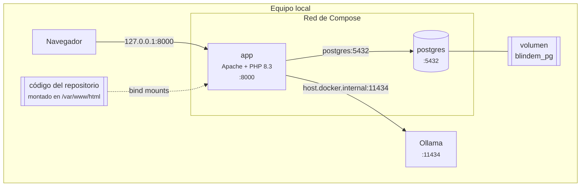
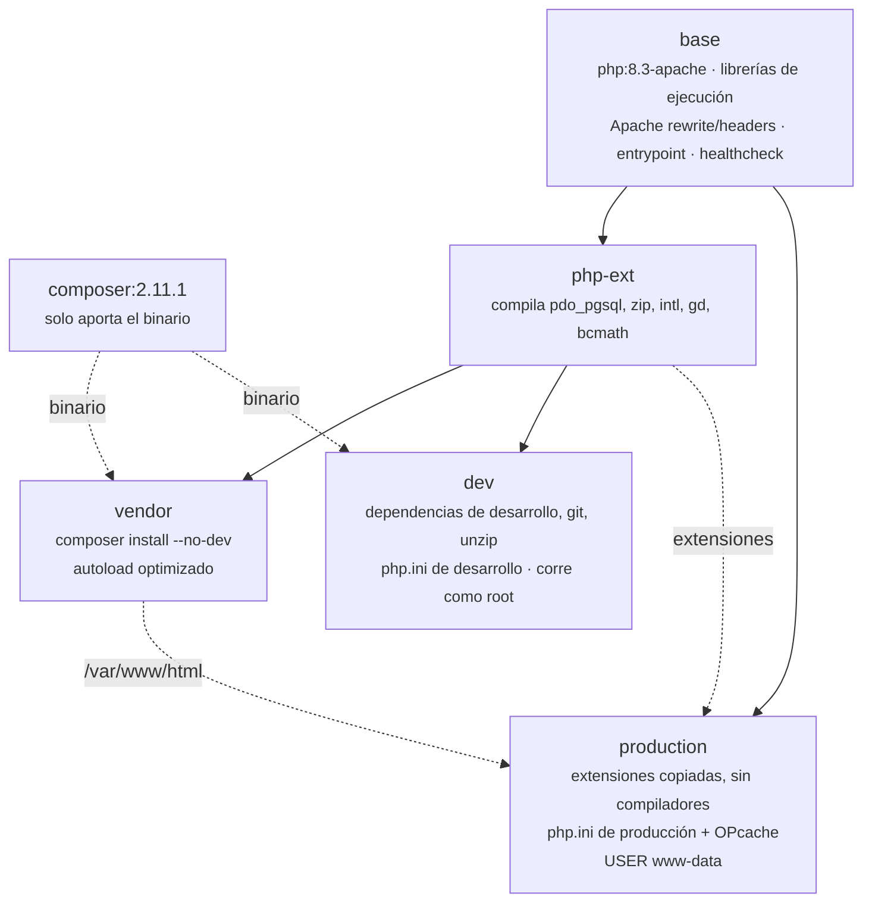
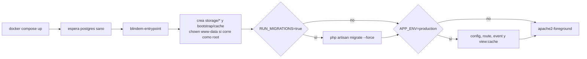

<p align="center"></p>

# Infraestructura: Docker, PostgreSQL y Ollama

Todo corre en el equipo local. Docker Compose levanta la aplicación y la base de datos; Ollama corre aparte, en el sistema operativo, para usar la GPU. Para la arquitectura general consulta [ARQUITECTURA.md](ARQUITECTURA.md); para el día a día, [OPERACION-LOCAL.md](OPERACION-LOCAL.md).



| Componente | Versión | Dónde | Puerto |
| --- | --- | --- | --- |
| PHP + Apache | 8.3.36, imagen `php:8.3.36-apache-bookworm` | contenedor `app` | `127.0.0.1:8000` |
| Laravel | 12 | contenedor `app` | — |
| PostgreSQL | 16, imagen `postgres:16-alpine` | contenedor `postgres` | solo red interna |
| Composer | 2.11.1 (etapa de build) | imagen | — |
| Ollama | 0.40.13, servicio de Homebrew | sistema operativo | `localhost:11434` |
| Docker Compose | v2 (probado con 5.5.0) | — | — |

## 1. Docker

### 1.1 Imagen multietapa

El `Dockerfile` define cinco etapas. Docker Compose usa `dev`; un `docker build` sin `--target` produce `production`.



| Etapa | Para qué |
| --- | --- |
| `base` | Librerías de ejecución (`libpq`, `libzip`, `libicu`, `gd`), módulos `rewrite` y `headers`, configuración de Apache en el puerto `${PORT}` (8000), entrypoint y `HEALTHCHECK` contra `/up` |
| `php-ext` | Compila las extensiones con sus cabeceras; los compiladores no llegan a producción |
| `vendor` | Dependencias de producción y autoloader optimizado |
| `dev` | La que usa Compose: incluye PHPUnit y las dependencias de desarrollo. Corre como root para que el entrypoint ajuste los permisos de `storage` sobre los volúmenes montados |
| `production` | Imagen mínima: sin compiladores, OPcache sin validar marcas de tiempo (`docker/php/production.ini`), código propiedad de root y solo `storage` y `bootstrap/cache` escribibles por `www-data` |

`.dockerignore` deja fuera `.env`, `vendor`, `tests`, `docs`, `backups` y la configuración de agentes, así que nunca entran secretos ni copias de seguridad en la imagen.

### 1.2 Servicios de Compose

```yaml
services:
  postgres:   # postgres:16-alpine, volumen blindem_pg, healthcheck pg_isready
  app:        # build target dev, puerto 127.0.0.1:8000, depende de postgres sano
volumes:
  blindem_pg:
```

| Aspecto | `app` | `postgres` |
| --- | --- | --- |
| Arranque | Espera a que `postgres` esté sano (`depends_on: condition: service_healthy`) | — |
| Salud | `php -r` pide `http://127.0.0.1:8000/up` cada 10 s | `pg_isready -U blindem` cada 5 s |
| Puertos | `127.0.0.1:8000:8000`, nunca en todas las interfaces | No publica puertos: solo lo ve `app` |
| Datos | Sin estado propio | Volumen `blindem_pg` en `/var/lib/postgresql/data` |
| Código | Bind mounts de `app/`, `config/`, `database/`, `public/`, `resources/`, `routes/`, `scripts/`, `tests/` y los `phpunit*.xml` | — |

Los bind mounts hacen que un cambio de código se vea al recargar la página sin reconstruir. `vendor/` y `bootstrap/cache` quedan dentro de la imagen; después de cambiar `composer.json` hay que reconstruir con `docker compose up --build -d --wait`.

### 1.3 Arranque del contenedor



En local `RUN_MIGRATIONS` vale `true`, así que cada arranque aplica las migraciones pendientes. Las cachés de configuración y rutas solo se generan en producción; en local Laravel lee el `.env` en cada petición.

### 1.4 Variables de entorno

Compose toma los valores del `.env` de la raíz y los pasa al contenedor. Después de cambiarlos, ejecuta `docker compose up -d --wait` para recrear `app`.

| Variable | Valor local | Para qué |
| --- | --- | --- |
| `APP_KEY` | generada por `setup-local.sh` | Cifrado de sesiones y cookies; no se muestra ni se versiona |
| `DB_*` | `postgres`, `blindem`, `blindem_local` | Conexión a PostgreSQL dentro de la red de Compose |
| `SESSION_DRIVER` | `database` | Sesiones en PostgreSQL |
| `CACHE_STORE` | `file` | Caché regenerable; aquí se guardan los embeddings del RAG |
| `LOG_CHANNEL` | `stderr` | Los logs salen en `docker compose logs app` |
| `AI_DRIVER` | `simulated` u `ollama` | Proveedor del asistente |
| `OLLAMA_BASE_URL` | `http://host.docker.internal:11434` | Ollama del equipo visto desde el contenedor |
| `OLLAMA_MODEL` | `qwen3.5:4b-mlx` | Modelo de chat |
| `OLLAMA_EMBED_MODEL` | `qwen3-embedding:0.6b` | Modelo de embeddings para el RAG; vacío = solo BM25 |
| `OLLAMA_THINK` | `false` | Razonamiento de los modelos que lo tienen |
| `OLLAMA_TIMEOUT`, `OLLAMA_NUM_CTX`, `OLLAMA_MAX_TOKENS` | `120`, `8192`, `1200` | Límite por petición, ventana de contexto y largo de respuesta |

La lista completa con comentarios está en `.env.example`.

### 1.5 Red hacia Ollama

`host.docker.internal` es el nombre con el que un contenedor llega al equipo anfitrión. Docker Desktop lo define en macOS y Windows; en Linux lo agrega la línea `extra_hosts: "host.docker.internal:host-gateway"` del `docker-compose.yml`, así que la misma configuración funciona en los tres sistemas.

Si la aplicación corre sin Docker, usa `OLLAMA_BASE_URL=http://localhost:11434`.

### 1.6 Comandos útiles

```bash
docker compose ps
```

```bash
docker compose logs -f app
```

```bash
docker compose exec app php artisan tinker
```

```bash
docker compose up --build -d --wait
```

No uses `docker compose down -v`: borra el volumen `blindem_pg` con todos los datos.

## 2. PostgreSQL

### 2.1 Conexión y bases

| Base | Uso | Cómo se crea |
| --- | --- | --- |
| `blindem` | Datos de la aplicación | La crea la imagen al iniciar el volumen por primera vez |
| `blindem_test` | Suite de pruebas sobre PostgreSQL (`phpunit.postgres.xml`) | `docker compose exec -T postgres createdb -U blindem blindem_test`, una sola vez |
| `blindem_restore_check` | Comprobar una copia de seguridad sin tocar la base real | Manual, ver 2.4 |

Para abrir una consola SQL:

```bash
docker compose exec postgres psql -U blindem -d blindem
```

Las credenciales `blindem` / `blindem_local` solo sirven dentro de la red de Compose: el puerto 5432 no se publica en el equipo.

### 2.2 Esquema

| Tabla | Contenido | Restricciones destacadas |
| --- | --- | --- |
| `users` | Usuarios y rol | `email` único, `role` ∈ {admin, collaborator} |
| `document_types`, `job_titles`, `contract_types`, `termination_reasons` | Catálogos administrables | `code` único; `contract_types.calculation_method`; `termination_reasons.implies_indemnification` |
| `companies` | Empleadores | `nit` único |
| `workers` | Trabajadores | Único por (`document_type_id`, `document_number`) |
| `contracts` | Contratos laborales con salario, fechas, días y deducciones | Claves foráneas con `restrictOnDelete`; motivo de retiro con `nullOnDelete` |
| `settlements` | Snapshots de liquidaciones: `inputs` y `result` en JSON, `net_amount`, `calculation_version` | Pertenece a un contrato; un contrato con historial no se elimina |
| `labor_parameters` | Salario mínimo, auxilio, tarifas y fuentes por año | `year` único |
| `sessions` | Sesiones de Laravel | Índices en `user_id` y `last_activity` |
| `migrations` | Control de migraciones | — |

El diagrama entidad-relación está en [ARQUITECTURA.md § 6](ARQUITECTURA.md#6-modelo-de-datos).

### 2.3 Migraciones e índices

| Migración | Cambio |
| --- | --- |
| `2026_01_01_000000_create_blindem_tables` | Esquema inicial |
| `2026_10_29_000001_add_labor_parameters_and_calculation_controls` | Vigencias por año (2023–2026 con sus decretos), método de cálculo por tipo de contrato, recargos separados de extras, tabla `sessions` |
| `2026_10_31_000001_allow_automatic_settlement_days` | Días de vacaciones en blanco = cálculo automático; días disfrutados |
| `2026_11_01_000001_index_foreign_keys` | Índice en cada clave foránea de `contracts` y `settlements`, más `settlements(contract_id, id)` para el historial |

PostgreSQL no indexa las claves foráneas por su cuenta; sin esos índices, filtrar contratos por empresa o borrar un catálogo recorre la tabla completa.

### 2.4 Copias de seguridad y restauración

```bash
sh scripts/backup.sh
```

El script ejecuta `pg_dump -Fc` dentro del contenedor y escribe `backups/blindem-<fecha UTC>.dump` con permisos `600`. Escribe primero un archivo `.partial` y lo renombra al terminar, así que una copia interrumpida nunca queda con el nombre final. La carpeta `backups/` está fuera de Git y de la imagen.

Para comprobar una copia en una base aparte:

```bash
docker compose exec -T postgres createdb -U blindem blindem_restore_check
```

```bash
docker compose exec -T postgres pg_restore -U blindem --no-owner --exit-on-error -d blindem_restore_check < backups/ARCHIVO.dump
```

```bash
docker compose exec -T postgres psql -U blindem -d blindem_restore_check -c 'SELECT count(*) FROM contracts; SELECT count(*) FROM settlements;'
```

## 3. Ollama

### 3.1 Instalación

Ollama está instalado con Homebrew como servicio que arranca con la sesión del usuario:

```bash
brew install ollama
```

```bash
brew services start ollama
```

Para detenerlo:

```bash
brew services stop ollama
```

### 3.2 Modelos

| Modelo | Tamaño | Uso | Motor |
| --- | --- | --- | --- |
| `qwen3.5:4b-mlx` | 4,0 GB | Chat del asistente (recomendado en Apple Silicon) | MLX |
| `qwen3-embedding:0.6b` | 639 MB | Embeddings del RAG, multilingüe | llama.cpp |
| `qwen2.5:7b` | 4,7 GB | Alternativa para Intel o Linux; unas 10 veces más lenta en este equipo | llama.cpp |
| `llama3.2` | 2,0 GB | Pruebas rápidas; inventa más | llama.cpp |

```bash
ollama pull qwen3.5:4b-mlx
```

```bash
ollama pull qwen3-embedding:0.6b
```

Con los dos modelos cargados, Ollama usa unos 6,4 GB de memoria unificada (5,4 GB el de chat con 8192 tokens de contexto, 1 GB el de embeddings). En un Mac de 16 GB conviene no cargar dos modelos de chat a la vez. Ollama descarga un modelo de memoria tras 5 minutos sin uso; la siguiente llamada tarda unos segundos más mientras lo vuelve a cargar.

```bash
ollama ps
```

### 3.3 Particularidades de qwen3.5

- **Sin salida estructurada.** Ollama responde `501 structured output is unavailable` cuando `format` lleva un JSON Schema. `OllamaAiClient` lo detecta, recuerda el modelo y repite la petición sin `format`, con el esquema dentro del prompt. La respuesta se valida igual que siempre.
- **Razonamiento apagado.** El cliente envía `think: false` salvo que `OLLAMA_THINK=true`. Con el razonamiento encendido el modelo tarda varias veces más y las respuestas se verifican de todas formas.

### 3.4 Tiempos medidos (Mac M2, 16 GB)

| Tarea | `qwen3.5:4b-mlx` | `qwen2.5:7b` | `llama3.2` |
| --- | --- | --- | --- |
| Pregunta | 4–9 s (con fuentes) | ~10 s | ~12 s |
| Explicación de la liquidación | ~40 s | ~70 s | 25–40 s |
| Rellenar contrato | ~60 s | 50–120 s | ~25 s |
| Búsqueda de fuentes (embeddings) | ~40 ms; ~8 s la primera vez, mientras calcula los vectores de las notas | — | — |

### 3.5 Diagnóstico

| Síntoma en la interfaz | Causa | Solución |
| --- | --- | --- |
| «No se pudo conectar con Ollama en http://host.docker.internal:11434» | El servicio no corre | `brew services start ollama` y probar `curl -s localhost:11434/api/tags` |
| «El modelo … no está disponible. Descárgalo con «ollama pull …»» | Falta el modelo | El comando que indica el mensaje |
| La etiqueta dice otro modelo distinto al de `.env` | El contenedor tiene la configuración anterior | `docker compose up -d --wait` |
| Las preguntas funcionan pero sin búsqueda semántica | Falta el modelo de embeddings o falló | `ollama pull qwen3-embedding:0.6b`; el log de `app` muestra «Semantic search unavailable» |
| Respuestas muy lentas | Modelo grande, razonamiento encendido o dos modelos de chat compitiendo por memoria | `ollama ps`, `OLLAMA_THINK=false`, usar `qwen3.5:4b-mlx` |
| «El modelo no devolvió una respuesta válida» | Salida que no es JSON | Reintentar o usar un modelo más capaz |

Para volver al modo sin red, pon `AI_DRIVER=simulated` en `.env` y ejecuta `docker compose up -d --wait`.

### 3.6 Ollama Cloud

El mismo cliente funciona con Ollama Cloud: `OLLAMA_BASE_URL=https://ollama.com`, una clave creada en https://ollama.com/settings/keys en `OLLAMA_API_KEY` y un modelo grande en `OLLAMA_MODEL`. Ten en cuenta que entonces los datos del contrato salen del equipo.
