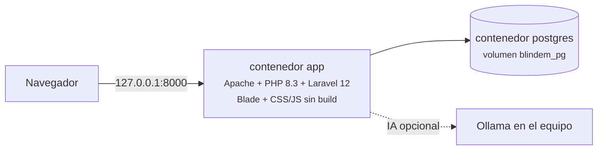

<p align="center"></p>

# Operación local

La aplicación corre completamente en el equipo: Laravel 12 sobre Apache/PHP 8.3 y PostgreSQL 16, orquestados con Docker Compose. No depende de servicios en la nube y el puerto se publica solamente en `127.0.0.1:8000`.

## Arquitectura



El detalle de imágenes, red, base de datos y modelos está en [INFRAESTRUCTURA.md](INFRAESTRUCTURA.md).

- **Datos:** PostgreSQL en un volumen Docker; también guarda las sesiones.
- **Motor de cálculo:** `app/Services/LaborSettlementCalculator.php` recibe un arreglo y devuelve el resultado; no consulta la base de datos. `SettlementInputs` arma esas entradas desde el contrato y la vigencia laboral del año de corte.
- **Exportación:** los XLSX se generan en memoria con PhpSpreadsheet y se descargan directamente.

## Inicio

Con Docker Desktop abierto, desde la raíz:

```bash
sh scripts/setup-local.sh
```

El script crea `.env` si falta, genera una clave sin mostrarla, conserva la clave existente, espera la salud de los servicios y carga datos demo. Los datos se conservan en el volumen PostgreSQL. Para aplicar cambios de código:

```bash
docker compose up --build -d --wait
```

No uses `down -v` para actualizar: elimina el volumen de datos. Una instalación existente con el campo combinado de extras/recargos debe editar esos contratos y confirmar la separación antes de generar nuevos cálculos. Las liquidaciones anteriores siguen disponibles.

## Asistente de IA

Por defecto el asistente usa reglas locales (`AI_DRIVER=simulated`). Para activar Ollama:

1. Inicia el servicio y descarga los modelos:

   ```bash
   brew services start ollama
   ```

   ```bash
   ollama pull qwen3.5:4b-mlx && ollama pull qwen3-embedding:0.6b
   ```

2. En `.env`: `AI_DRIVER=ollama`, `OLLAMA_MODEL=qwen3.5:4b-mlx`, `OLLAMA_EMBED_MODEL=qwen3-embedding:0.6b`.
3. Recrea el contenedor para que lea los valores:

   ```bash
   docker compose up -d --wait
   ```

La etiqueta «IA · Ollama · qwen3.5:4b-mlx» en la interfaz confirma el cambio. Errores frecuentes y su solución en [INFRAESTRUCTURA.md § 3.5](INFRAESTRUCTURA.md#35-diagnóstico).

## Administradores

Para crear un administrador adicional sin datos demo:

```bash
docker compose exec app php artisan blindem:admin admin@tuempresa.com --name="Administrador"
```

La contraseña se solicita sin mostrarla y debe tener al menos 12 caracteres. Los parámetros laborales 2023–2026 los instala la migración; las siguientes vigencias se registran desde Administración → Parámetros laborales.

## Sesiones y almacenamiento

Las sesiones se guardan en PostgreSQL y sobreviven a recrear el contenedor. La caché de archivos y las vistas compiladas son regenerables; no almacenan datos de negocio. Las exportaciones se transmiten directamente y no necesitan disco persistente.

## Backups y restauración

```bash
sh scripts/backup.sh
```

Produce un dump de PostgreSQL en `backups/`, con permisos privados y excluido de Git. Para verificar una copia, usa una base nueva sin sustituir la aplicación:

```bash
docker compose exec -T postgres createdb -U blindem blindem_restore_check
docker compose exec -T postgres pg_restore -U blindem --no-owner --exit-on-error -d blindem_restore_check < backups/ARCHIVO.dump
docker compose exec -T postgres psql -U blindem -d blindem_restore_check -c 'SELECT count(*) FROM contracts; SELECT count(*) FROM settlements;'
```

## Pruebas

```bash
docker compose exec -T app vendor/bin/phpunit
docker compose exec -T postgres createdb -U blindem blindem_test
docker compose exec -T app vendor/bin/phpunit -c phpunit.postgres.xml
docker compose exec -T app php scripts/verify_calculator.php
```

Crea `blindem_test` solo la primera vez. Las pruebas usan SQLite en memoria por defecto; la configuración adicional apunta exclusivamente a `blindem_test`. La clase base bloquea su ejecución si detecta otro nombre o un entorno distinto de `testing`.
