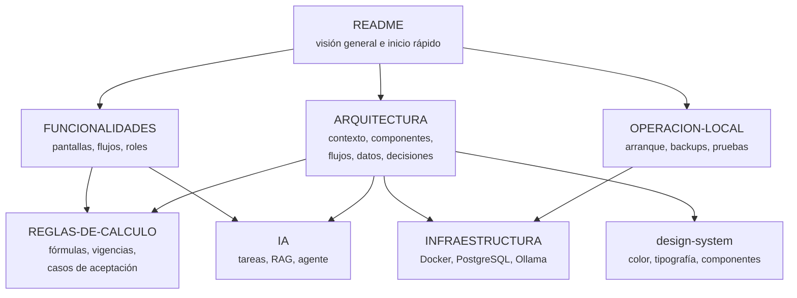

<p align="center"></p>

<h1 align="center">Documentación</h1>

<p align="center">Todo lo que hay que saber de Blindem Liquidaciones, de lo que hace a cómo está construido.<br><a href="../README.md">← Volver al README</a></p>

## Por dónde empezar

| Si quieres… | Lee |
| --- | --- |
| Entender qué hace la app y qué facilita | [Guía funcional](FUNCIONALIDADES.md) |
| Ponerla a correr en tu equipo | [Operación local](OPERACION-LOCAL.md) |
| Saber cómo está construida | [Arquitectura](ARQUITECTURA.md) |
| Revisar las fórmulas y decisiones jurídicas | [Reglas de cálculo](REGLAS-DE-CALCULO.md) |
| Configurar o extender el asistente de IA | [Asistente de IA](IA.md) |
| Ajustar Docker, PostgreSQL u Ollama | [Infraestructura](INFRAESTRUCTURA.md) |
| Cambiar o ampliar la interfaz | [Sistema de diseño](design-system.md) |

## Mapa de documentos



## Material visual

| Recurso | Contenido |
| --- | --- |
| [screenshots/](screenshots) | Capturas de la aplicación con datos de demostración (escritorio, móvil y modo oscuro) |
| [assets/logo.svg](assets/logo.svg) | Icono de la aplicación (el mismo de `public/favicon.svg`, a mayor tamaño) |
| [design-system.html](design-system.html) | Guía visual de componentes, campos y estados |
| [ui-preview.html](ui-preview.html) y [login-preview.html](login-preview.html) | Vistas previas estáticas del resumen y del acceso |

Las vistas previas HTML cargan `public/css/app.css` y `public/js/app.js`. Para abrirlas sin PHP, desde la raíz del proyecto:

```bash
python3 -m http.server 8765 --bind 127.0.0.1
```

Y abre `http://127.0.0.1:8765/docs/ui-preview.html`.

## Actualizar las capturas

Con la aplicación corriendo en `http://127.0.0.1:8000` y los datos de demostración cargados, las capturas se toman a 1440 × 900 (móvil 390 × 844) con densidad 2× y se reducen a 1800 px de ancho en JPEG para que el repositorio no crezca. Conserva los nombres de archivo: el README y la guía funcional los enlazan.
